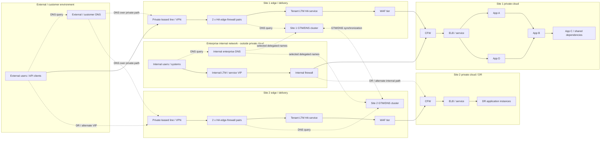

# EnterpriseWAF Current Architecture and Stable Invariants

**Status:** Authoritative current-state architecture, topology and stable-invariant baseline  
**Change policy:** Change this file only when the real enterprise environment, ownership boundary, business requirement or supported application scope changes. Do not place target-state improvements or preferred design choices here.

**Future / target-state improvements:** [future_architecture_improvements.md](./future_architecture_improvements.md)

# 1. Purpose

This file is the single grounding source for **what exists today, how the current architecture is laid out, and what is treated as a stable enterprise fact**.

Use it to ground:

- architecture diagrams;
- management slides;
- WAF topology comparisons;
- failure and recovery analysis;
- health-check and DNS/GTM analysis;
- cross-site design studies.

Where the exact current implementation has not yet been confirmed, this file says **unknown / validate** rather than silently treating a desired future design as current state.

# 2. Stable current-state summary

| Area | Current-state / stable fact |
|---|---|
| **Sites** | Two sites: **Site 1** and **Site 2**, treated as separate infrastructure and routing failure domains |
| **Primary estate** | Four-tenant **extranet** application-delivery environment; the wider estate may contain approximately 3-4 tenant/hosting contexts |
| **External access** | External partner/customer users and API clients primarily use private leased-line / VPN-style connectivity |
| **GTM / DNS** | One **BIG-IP DNS/GTM cluster per site**; the site clusters communicate/synchronize the enterprise GTM/DNS view |
| **GTM placement** | GTM/DNS is an **edge service inside the edge-firewall security boundary** |
| **External DNS use** | External/customer DNS reaches the enterprise edge GTM over the private leased-line/VPN path through the edge firewall |
| **Internal DNS use** | Internal users use **internal enterprise DNS**; selected endpoint names/namespaces can be delegated or conditionally forwarded to the **same edge GTM service** |
| **Edge firewalls** | Each tenant/site has **two HA edge-firewall pairs, two devices per pair (2 x 2 devices)** |
| **External VIPs** | Externally reachable application VIPs live on the edge-firewall tier |
| **LTM** | Existing tenant LTM HA boundaries are retained; the default model is **two LTMs per tenant/site in an HA/Sync-Failover pair** |
| **WAF / BIG-IP platform** | Current estate runs **BIG-IP 17.5.x** (LTM, BIG-IP DNS/GTM, Advanced WAF/ASM; EoTS Jan 1, 2029 per F5 `K15643`). Exact WAF topology/sharing is a design variable; rebuild onto newer hardware/software (e.g., rSeries/VELOS/F5OS + BIG-IP 21.1.x+) is a **target-state** change tracked in `future_architecture_improvements.md` |
| **Internal network** | Internal users/desktops/systems, internal DNS and internal service/LTM VIPs are **outside the private-cloud boundary** |
| **Internal firewall** | A distinct **internal firewall** separates the enterprise internal network from private cloud |
| **Private-cloud firewall** | A distinct **CFW** sits in front of private-cloud ELB/service endpoints |
| **Applications** | Applications may run on VMs, Kubernetes, PaaS or on-premises platforms; App A/B/C/D dependency chains are first-class availability dependencies |
| **Application mode** | Most applications are active/passive; some passive-site applications may require manual startup; some applications may be active/active |
| **Availability requirement** | Evaluate the service against a **99.95% availability target**, including planned maintenance where applicable |
| **Cross-site routing** | Cross-site WAF/front-end/dependency routing is **not assumed to exist today** unless separately confirmed |

# 3. Architecture planes and parallel paths

Do **not** treat the architecture as one linear inline stack: external and internal access are **parallel ingress paths** that converge at the private-cloud delivery tier, while DNS/GTM and health/observability are **control planes**.

| Plane / Path | Current role | Current boundary |
|---|---|---|
| **Client / resolver plane** | external users/API clients, external/customer DNS, internal users, internal enterprise DNS | outside application-delivery/private-cloud stack |
| **DNS / site-selection control plane** | Site 1 and Site 2 BIG-IP DNS/GTM clusters; answers selected external and delegated internal names (not an inline data hop) | edge service inside edge-firewall boundary |
| **External ingress path** | private leased line/VPN -> 2 x 2 edge firewalls / external VIPs -> tenant LTM HA service -> WAF tier | extranet / site edge & tenant delivery |
| **Internal ingress path** | internal LTM/service VIP -> distinct **internal firewall** (may bypass external WAF) | enterprise internal network -> private cloud |
| **Private-cloud delivery tier** | distinct **CFW** -> ELB/service (where external and internal paths converge) | private-cloud boundary |
| **Application + dependency tier** | App A/B/C/D, sessions, state, DB, identity, event services, and App A/D -> B -> C chains | application/platform |
| **Health / observability / recovery plane** | cross-cutting across HA, local member, endpoint, dependency and synthetic tiers (not an inline hop) | cross-cutting |

# 4. Site and edge architecture

For a representative tenant, each site has the same core edge structure unless a design option explicitly says otherwise:

```text
Site
  -> 2 HA edge-firewall pairs
       -> 2 devices per HA pair (2 x 2 devices)
  -> site GTM/DNS cluster
  -> tenant LTM HA service
  -> WAF tier
  -> private-cloud CFW
  -> ELB/service
  -> application
```

The two sites remain separate failure domains.

The GTM synchronization relationship does **not** mean GTM synchronizes LTM/WAF/CFW/application configuration. Those remain separate service and configuration domains.

# 5. DNS / GTM current state

## 5.1 Control-plane rule

BIG-IP DNS/GTM is a **DNS control-plane / endpoint-selection service**. It is not an inline hop in the HTTP/TCP application session.

DNS resolution and subsequent application traffic must therefore be drawn as separate flows.

## 5.2 External DNS resolution

Representative control path:

```text
External user/system
  -> external/customer DNS resolver
  -> private leased line / VPN / extranet path
  -> edge firewall
  -> enterprise edge BIG-IP DNS / GTM cluster
  -> DNS answer containing selected external/firewall application VIP
```

The application connection then uses the returned VIP and does **not** pass through GTM as an inline proxy.

## 5.3 Internal DNS resolution

Internal users and systems use internal enterprise DNS.

For selected endpoint names or namespaces, internal DNS may delegate or conditionally forward to the **same enterprise edge GTM service** used for external endpoint selection.

Representative control path:

```text
Internal user/system
  -> internal enterprise DNS
  -> [selected delegated / conditionally forwarded name]
  -> enterprise edge BIG-IP DNS / GTM cluster
  -> DNS answer containing internal service/LTM VIP
```

The application data path then follows the internal service path described in section 8.

Internal and external DNS namespaces/answers are logically distinct even where the same GTM platform participates in both.

# 6. Current GTM health-check state: known facts and items to validate

The **architecture and placement of GTM are known**, but the exact current health-monitoring implementation has not yet been fully validated in this analysis.

Do **not** draw the following as current-state facts until confirmed.

| Item | Current status |
|---|---|
| GTM uses only TCP/port checks versus HTTP/L7 checks | **Unknown - validate** |
| GTM directly performs L7 health checks against each **external VIP** | **Unknown - validate** |
| GTM directly performs L7 health checks against each **internal VIP** used for delegated internal names | **Unknown - validate** |
| GTM consumes LTM virtual-server/application health using iQuery | **Unknown - validate** |
| Site 1 GTM probes Site 2 endpoints and Site 2 GTM probes Site 1 endpoints | **Unknown - validate** |
| GTM synchronization group/prober-pool behavior and availability requirements | **Unknown - validate** |
| Monitor intervals, timeouts and up/down thresholds | **Unknown - validate** |
| Application-owned readiness endpoints exist for all critical services | **Unknown - validate** |
| Health checks include CFW -> ELB -> application reachability | **Unknown - validate** |
| Health checks include critical App A -> B -> C dependencies | **Unknown - validate per application** |
| Independent external/user-like synthetic monitoring feeds the SLO | **Unknown - validate** |

### Why this matters

A TCP/port-only check can be green while the business service is unusable, for example:

```text
GTM sees listener UP
        |
        v
WAF/LTM TCP port responds
        |
        X
CFW / ELB / application unavailable
```

That is a **false-green health state**.

The target health-check design is therefore treated as a **future improvement** and is documented separately in [future_architecture_improvements.md](./future_architecture_improvements.md).

# 7. Canonical current-state topology



# 8. Current application data paths

## 8.1 External application path

```text
External partner/customer or API client
  -> private leased line / VPN / extranet path
  -> edge firewall / external application VIP
  -> tenant LTM HA service
  -> WAF tier
  -> private-cloud CFW
  -> ELB/service
  -> application workload
```

A WAF topology comparison may change how traffic is handled between LTM and CFW, but it must not silently change the surrounding stable layers.

## 8.2 Internal user path

Internal users may bypass the external WAF tier.

```text
Internal user / desktop / system
  -> internal enterprise DNS
  -> [optional GTM delegation/forwarding for selected names]
  -> internal LTM / service VIP
  -> internal firewall
  -> private-cloud CFW
  -> ELB/service
  -> application
```

Boundary rules:

- internal users, internal DNS and internal LTM/service VIPs are outside private cloud;
- the **internal firewall** and **CFW** are different security, state and failure domains;
- an internal-firewall failure can block internal users while the external path remains healthy;
- a CFW failure can affect both external and internal callers when both paths converge on the same private-cloud CFW.

# 9. Application hosting and dependency paths

Applications can be hosted using one or more of these patterns:

## H1 - on-premises

```text
WAF/LTM
  -> application LB/VIP
  -> servers/VMs
```

## H2 - private-cloud VM

```text
WAF/LTM
  -> CFW
  -> ELB
  -> VM pool
```

## H3 - private-cloud Kubernetes

```text
WAF/LTM
  -> CFW
  -> ELB
  -> Kubernetes ingress/service
  -> pods
```

## H4 - PaaS / stable service endpoint

```text
WAF/LTM
  -> CFW
  -> stable/floating ELB/service endpoint
  -> Site 1 or Site 2 workload
```

## 9.1 App A / B / C / D dependencies

Application-to-application calls must be analysed separately from north-south WAF ingress.

Representative dependency chain:

```text
Application A ----\
                  -> Application B -> Application C
Application D ----/
```

The dependency can use:

- a site-local/static endpoint;
- internal DNS;
- selected internal DNS delegation/forwarding to GTM;
- private-cloud service discovery;
- a stable internal service VIP.

The current existence of an automatic **B1 -> B2 cross-site fallback** is not assumed unless confirmed.

# 10. Application classes in scope

Every relevant failure scenario must distinguish:

- **AT1 - stateless web**;
- **AT2 - stateful web**;
- **AT3 - WebSocket/socket/long-lived connection**;
- **AT4 - non-web/L4 application that may bypass WAF**.

Infrastructure recovery is not considered complete until the application-specific recovery requirement is also satisfied.

Typical implications:

- stateless web: retry/idempotency;
- stateful web: session/state portability and transaction reconciliation;
- WebSocket: reconnect, re-authenticate, re-subscribe, sequence/gap recovery and replay;
- non-web/L4: protocol-specific reconnect/re-resolution/replay behavior.

# 11. Current availability requirement and reporting rule

Use **99.95% availability** as the service-level target to assess.

If planned maintenance counts against the SLO, 99.95% corresponds approximately to:

- **4 hours 22 minutes 48 seconds per year**;
- **21 minutes 54 seconds per average month**;
- **5 minutes 2 seconds per week**.

Every failure analysis must report outcomes separately for:

- external human users;
- external systems/API clients;
- internal users/systems;
- dependent applications such as App A -> B -> C.

The preferred service RTO measure is:

> **time from fault to the first successful business transaction for the affected actor**

not simply "device green" or "WAF recovered".

# 12. Current ownership / scope constraints

The current WAF study does **not** assume:

- GTM/LTM consolidation;
- a new shared-LTM design;
- cross-site WAF route-back;
- cross-site application-dependency routing;
- a particular GTM L7 health-check implementation;
- a particular cross-site GTM prober model.

Those are target-state design choices requiring the relevant GTM/LTM/network/firewall/platform/application owners.

# 13. What belongs outside this current-state file

The following are **future / target-state improvements**, not stable current facts:

- target health-check placement and depth;
- GTM L7 checks against external/internal VIPs;
- cross-site/distributed GTM prober strategy;
- application health-check contracts;
- remote-WAF X2A/X2B routing;
- App B cross-site fallback XD1;
- preferred WAF sharing topology;
- maintenance/canary/rollback improvements;
- acceptance testing required before claiming 99.95%.

Document them in:

- [future_architecture_improvements.md](./future_architecture_improvements.md)

Topology and F5 implementation choices remain in:

- [analysis_variables_and_f5_assumptions.md](./analysis_variables_and_f5_assumptions.md)

Derived resilience conclusions remain in the executive, deployment, failure and maintainability documents.


# 14. Current-state diagram rules

Current-state diagrams must:

- keep DNS/GTM control-plane flows separate from application data paths;
- show external and internal DNS/VIP paths separately where they differ;
- retain the distinct internal firewall and private-cloud CFW boundaries;
- preserve Site 1 and Site 2 as separate failure domains;
- show application dependencies where they materially affect availability;
- avoid drawing target-state capabilities as deployed facts.

Do **not** silently show the following as current state unless validated:

- GTM Layer-7 checks of every external/internal VIP;
- direct cross-site GTM probing;
- X2A/X2B remote-WAF/front-end routing;
- automatic B1 -> B2 dependency fallback;
- a preferred shared-WAF target topology.

Those belong in [future_architecture_improvements.md](./future_architecture_improvements.md) and the relevant option-analysis documents.
