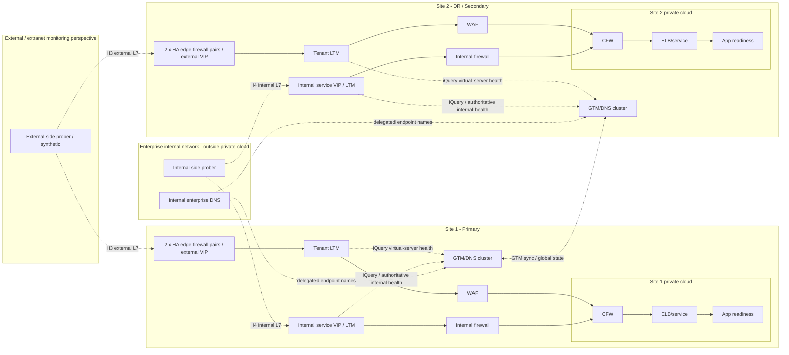

# EnterpriseWAF Future Architecture Improvements

**Status:** Target-state / to-be end-to-end application-delivery guidance  
**Current-state source:** [current_architecture_and_invariants.md](./current_architecture_and_invariants.md)  
**Purpose:** Keep proposed target-state improvements (layered end-to-end health monitoring, cross-site contingency, and future hardware/BIG-IP rebuild) separate from the validated BIG-IP 17.5.x current-state baseline. Execution starts with the **WAF tier** (and its F5 LTM/GTM interfaces) while aligning partner-owned tiers (Network/Security firewalls, Cloud Platform CFW/ELB, and Application teams) through explicit readiness and recovery contracts.

# 1. Target decision

The target architecture is a **joint responsibility** between infrastructure and application teams, supported by a **layered** health and recovery model:

- **Infrastructure teams** (F5/ADC, Network/Security, Cloud Platform) deliver resilient, rolling-upgradeable infrastructure (`K + 2` / `N-2` headroom, deterministic SNAT/routing/header propagation, and layer-accurate health steering);
- **Application teams** build applications that recover cleanly from transient, node, dependency, and site failures (`T6`), own Layer-7 readiness contracts, and explicitly declare client-IP, session-affinity, and protocol requirements;
- **Health checks and recovery** are placed at the exact right layer and clearly articulated so every team can architect against unambiguous contracts.

> **BIG-IP DNS/GTM should own the global endpoint/site decision, but it should not be the only place where health is detected and it does not need to originate every probe itself.**

The preferred model is:

1. **native HA** detects device/peer failure;
2. **LTM / ELB / service-tier health** removes failed local members quickly;
3. **GTM owns external and internal published-endpoint availability** used for DNS/site selection;
4. the **probe origin is chosen so the check crosses the failure domain GTM is deciding about**;
5. application teams own the Layer-7 readiness contract;
6. independent external/internal synthetic monitoring measures the actual 99.95% service outcome.

This keeps the recovery domain proportional to the failure. One backend, WAF node or pool member should normally stay a local recovery event rather than trigger DNS/site failover.

# 2. The important distinction: decision owner versus probe origin

The best place for the **decision** and the best place for the **probe** are not always the same.

| Decision | Decision owner | Preferred health source / probe origin | Reason |
|---|---|---|---|
| one HA peer/device | native HA subsystem | peer/device health | fastest local takeover |
| one WAF/backend/pool member | LTM / ELB / service tier | local protocol/L7 member monitor | remove only the failed member |
| **external site/VIP selection** | **GTM/DNS** | L7 probe from an **external/extranet-representative vantage** where possible; otherwise a useful GTM prober/LTM+iQuery signal plus external synthetic confirmation | GTM controls the external DNS answer, but a probe originating inside the edge may not prove the full external path |
| **internal delegated-name/site selection** | **GTM/DNS** | L7 probe from an **internal-network vantage before the internal firewall**, or authoritative internal LTM health exported through iQuery | proves the internal VIP path that internal DNS is delegating to GTM |
| B1/B2 dependency selection | service VIP/LTM/service discovery; GTM only if GTM owns that endpoint selection | dependency-specific health | avoids broad application/site failover |
| 99.95% SLO | monitoring/SRE platform | independent user-like synthetic | measures real service outcome rather than infrastructure state |

## Target rule

> **GTM owns the answer; the probe should be sourced from a location that actually exercises the path represented by that answer.**

This is especially important because the GTM clusters are inside the edge-firewall boundary. A GTM-originated monitor can validate application reachability, but depending on routing/NAT it may not reproduce the same inbound path used by an external customer.

# 3. Recommended health layers

| Health layer | Best place | What it proves | Action it should drive |
|---|---|---|---|
| **H1 - device / HA liveness** | firewall/LTM/WAF/CFW native HA | peer/process/interface availability | local HA takeover only |
| **H2 - local member health** | LTM / ELB / closest service tier | member or WAF-node readiness | remove failed member locally |
| **H3 - external published endpoint** | GTM-owned health using a representative external/extranet prober, direct GTM L7 monitor, and/or authoritative iQuery signal | external VIP path to application readiness | external wide-IP/site choice |
| **H4 - internal published endpoint** | GTM-owned health using an internal-zone prober or authoritative internal LTM/iQuery signal | internal VIP -> internal firewall -> CFW -> ELB -> application | internal delegated-name/site choice |
| **H5 - dependency/service health** | service VIP/LTM/service discovery | B1/B2 or other dependency readiness | dependency-local recovery |
| **H6 - independent synthetic** | monitoring platform outside the traffic-management stack | real external/internal/API business transaction | SLO measurement, alerting, failover validation |

GTM should therefore be the **authoritative site/endpoint steering layer**, but not the only health-check layer.

# 4. Target external VIP health

For every critical externally published application, GTM should have an authoritative Layer-7 view of each site's external endpoint.

Target path to prove:

```text
external/extranet health vantage
  -> private leased line / VPN path where feasible
  -> edge firewall / external application VIP
  -> tenant LTM
  -> WAF
  -> CFW
  -> ELB/service
  -> application readiness endpoint
```

## Preferred probe order

1. **Best representation:** a prober/synthetic vantage that actually traverses the external/extranet ingress path.
2. **Useful infrastructure signal:** direct GTM HTTP/HTTPS monitor if routing makes its path representative enough.
3. **Useful authoritative local signal:** LTM virtual-server/application health exported to GTM through iQuery.
4. **Independent external synthetic:** always recommended for SLO evidence even when it is not the automatic steering signal.

A GTM located behind the edge firewall can legitimately perform application L7 monitoring, but that does not automatically prove customer leased-line reachability or the outside-to-inside firewall path. Document exactly what each probe crosses.

# 5. Target internal VIP health

Internal clients continue to use **internal enterprise DNS**. Only selected endpoint names/namespaces should be delegated or conditionally forwarded to GTM when site-aware endpoint selection is required.

Target resolution path:

```text
internal client
  -> internal enterprise DNS
  -> delegated / conditionally forwarded namespace
  -> enterprise edge GTM/DNS
  -> healthy internal service VIP
```

Target application path to prove:

```text
internal-network health vantage
  -> internal service/LTM VIP
  -> internal firewall
  -> private-cloud CFW
  -> ELB/service
  -> application readiness endpoint
```

For internal VIP health, prefer:

- a GTM-designated prober that can reach the internal VIP from the correct internal-network side; or
- an internal LTM Layer-7 monitor whose virtual-server/application state is exported to GTM via iQuery.

Do not require every internal name to use GTM. Use GTM only for names where global/site-aware selection provides value.

# 6. Separate external and internal endpoint state

The same application can have different health on the two access paths.

Examples:

- external unhealthy / internal healthy: edge firewall, leased-line, WAF or external VIP problem;
- internal unhealthy / external healthy: internal LTM/VIP or internal-firewall problem;
- both unhealthy: CFW, ELB, application or common dependency problem.

Do not collapse these into one generic application state unless the business intentionally wants both namespaces withdrawn together.

Where GTM serves both external and delegated internal namespaces, keep the **wide-IP/pool/monitor policy separate enough to represent the different endpoint paths**.

# 7. Direct GTM monitor, iQuery, and prober pools

F5 BIG-IP DNS supports direct health monitors and integration with BIG-IP LTM through iQuery. It also supports selecting probing systems/prober pools and availability requirements.

The target should use these capabilities according to path fidelity rather than picking one mechanism globally.

## 7.1 Direct GTM Layer-7 monitor

Use when the selected GTM/prober can reach the target VIP through a path that usefully represents the endpoint being advertised.

The monitor should verify more than TCP connect. For HTTP/HTTPS, use a stable send/receive contract so the monitor confirms expected application content/readiness.

## 7.2 LTM/iQuery health and firewall NAT considerations

Use when LTM is the better observer of the local application path or when direct GTM probing cannot safely/reliably traverse the desired path.

```text
LTM performs L7 service/path health
        |
        v
BIG-IP DNS/GTM consumes virtual-server health via iQuery
        |
        v
GTM makes external/internal site-selection decision
```

**F5 BIG-IP DNS / LTM integration guardrails (official F5 docs):**

- **Firewall NAT & disabled Auto-Discovery (`K14707`, `K9138`):** Because external application VIPs live on the edge firewall (NATted to private LTM VIPs), BIG-IP DNS server/virtual-server objects must be configured with the external firewall VIP as `Address` and the private LTM VIP as `Translation`, and firewall policy must permit **TCP 4353 (iQuery)**. Specifying a `Translation` address **automatically disables Virtual Server Auto-Discovery** (`K9138`), so virtual-server inventory must be explicitly managed (or automated via AS3/BIG-IQ) to prevent drift.
- **Avoid duplicate monitoring (`K5431`):** When using the `bigip` monitor over iQuery, do not stack redundant direct monitors on both the LTM virtual server and the GTM virtual server unless a separate path-verification perspective is intentionally required.

## 7.3 Prober pools / multiple perspectives

For critical services, define explicitly:

- which systems probe Site 1 external VIPs;
- which systems probe Site 2 external VIPs;
- which systems probe internal VIPs;
- whether a local and a remote/corroborating perspective are used;
- how many successful probes are required;
- how inter-site network loss should affect the result.

**F5 prober-pool guardrails (official F5 docs):**

- Without explicit **Prober Pools** (`Specific Prober Pool`, `K08433560`), BIG-IP DNS dynamically delegates probing across any `big3d` device in the data center (`K8170`).
- F5 documents (`K000163083`) that after maintenance or iQuery reconnection, BIG-IP DNS may temporarily pick an LTM outside the configured prober pool; if that device lacks routes to the target across segmented firewall zones, probes fail with `no route` and mark healthy endpoints down. Validate routing and prober-pool fallback behavior explicitly.
- When an LTM in a prober pool runs a non-`bigip` monitor (such as TCP/HTTP) against a virtual server local to itself without SNAT, F5 documents (`K000159606`) potential physical-MAC vs. MAC-masquerade flapping on the network.

Use `All`, `At Least`, or `Require` semantics only after testing the failure behavior. **Do not create a design where loss of the inter-site link alone marks an otherwise healthy local site down.**

# 8. Canonical target health diagram



The exact prober product/location is an implementation choice. The architectural requirement is that the selected signal proves the intended access path closely enough for the DNS decision it drives.

# 9. Application-team Layer-7 health contract

Layer-7 health only works when the application team defines what **ready to accept new traffic** means.

Each protected endpoint should have a health contract covering:

| Field | Required decision |
|---|---|
| hostname / SNI | exact host sent by the monitor |
| URI | stable readiness endpoint, e.g. `/health/ready` |
| method | normally GET/HEAD unless justified otherwise |
| expected status | e.g. HTTP 200 |
| expected content | small stable receive string where useful |
| authentication | none, dedicated credential, certificate or token as appropriate |
| critical dependencies | dependencies that must be available to accept traffic |
| non-critical dependencies | dependencies that should not withdraw the whole service |
| timeout | normal/degraded response boundary |
| maintenance semantics | how the application intentionally leaves service (e.g., returning a **Receive Disable String** per F5 `K12818` so LTM/ELB drains traffic cleanly before shutdown) |
| owner | application team responsible for versioning the contract |

## Avoid false green

```text
TCP 443 works
  -> WAF/LTM looks healthy
  -> CFW/ELB/application is broken
  -> GTM still advertises the site
```

**F5 LTM Virtual Server false-green guardrail (`K40554304`):** By default (`Immediate Action On Service Down = None`), a BIG-IP LTM virtual server continues to complete TCP 3-way handshakes even when all pool members are offline. Set `Immediate Action On Service Down = Reject` or `Drop` on virtual servers where upstream TCP probes must not see a false-green listener.

## Avoid false red and cascades

Do not make App A globally unhealthy simply because an optional/non-critical App B/C feature is degraded. Otherwise one shared dependency can cause GTM to withdraw several healthy applications and create an avoidable site failover.

# 10. Health action boundaries

| Failure | Preferred detector | Preferred action |
|---|---|---|
| one backend/Pod/VM | ELB/LTM/service monitor | remove member locally |
| one independent WAF node | LTM WAF-pool monitor | remove WAF locally |
| one LTM peer | BIG-IP HA | local peer takeover |
| one CFW member | CFW HA | local firewall takeover |
| whole external endpoint path unusable | GTM external endpoint health | change external wide-IP/site answer |
| whole internal endpoint path unusable | GTM internal endpoint health | change delegated internal endpoint/site answer |
| App B local instance fails | B service VIP/service discovery | B1 -> B2 where safe |
| whole site lost | GTM + site/application readiness | Site 2 recovery |

# 11. GTM synchronization and convergence target

Measure the site failover as separate stages:

```text
1. path/service fails
2. local detector/prober sees failure
3. GTM obtains authoritative unhealthy state
4. GTM synchronization/global state converges where required
5. alternate endpoint becomes eligible
6. GTM returns the alternate answer
7. residual DNS TTL/cache expires or client re-resolves
8. application/session/socket recovery completes (T6)
```

If each site has direct/cross-site visibility of the relevant endpoint, step 3/4 may be faster and less dependent on indirect state learning.

If GTM probes are site-local only, **measure and include the remote GTM state-learning/synchronization delay**. DNS TTL is not the whole failover time.

# 12. Independent synthetics and the 99.95% SLO

Add independent user-like tests from representative viewpoints:

- external/private-network client perspective;
- internal desktop/system perspective;
- important API/system perspective.

Use them for:

- 99.95% SLO measurement;
- business transaction/error-rate validation;
- confirming DNS/firewall/authentication issues that infrastructure monitors can miss;
- validating failover and maintenance tests.

Normally, independent synthetic monitoring should **confirm** availability rather than be the only automatic GTM steering input unless its false-positive and timing behavior have been explicitly proven.

# 13. Dependency-local recovery

For App A/D -> B -> C chains, prefer dependency-local recovery before broad application/site failover where business semantics allow it.

```text
App A / App D
      |
B service VIP / discovery
   /             \
B1 Site 1      B2 Site 2
preferred       fallback
      |
    App C
```

Required controls include bounded timeouts, retry with backoff/jitter, circuit breaker/bulkhead, idempotency/reconciliation, compatible state/data, service identity, fallback capacity and pre-approved routing/firewall policy.

Healthy local applications must not depend on the inter-site link during normal operation.

# 14. Cross-site delivery improvements

Evaluate as **target contingency capabilities**, not current-state assumptions:

- **X2A** - surviving local LTM borrows a remote WAF and routes back to the healthy local application;
- **X2B** - remote front end routes back to a healthy primary-site application;
- **XD1** - App A/D stays local but uses remote App B;
- **X2C** - conventional full site/application failover.

Prefer the smallest safe recovery domain.

# 15. WAF topology, variants (`W1-3`, `W1-2`, `S1`, `S1+2`), 25% impact cap, and maintainability

Continue to evaluate against both the **99.95% combined managed+unmanaged availability target** and the **potential ≤ 25% maximum impact threshold** (≤ 1 of 4 tenants, and ≤ 25% capacity/canary exposure):

1. **`S1+2` — tenant-specific LTM pairs + shared independent active WAF pool with `+2` extra active WAFs/site (`K + 2`, e.g., `4 + 2 = 6` active `r2800`s/site = `12` WAFs total; `8 vCPU / 24 GB` each):** The **recommended shared-pool variant** — explicitly adds **+2 active WAFs per site** above peak `K` so the pool can simultaneously absorb **rolling upgrades (4/yr) + 1 unplanned hardware/SSD outage + isolated canary policy/firmware testing (≤ 17–25% exposure)** with **0% capacity loss** (requires strict per-tenant Parent/Child policy isolation and staged canary rollout so a bad change never exceeds the 25% cap).
2. **`S1` baseline (`S1-4`, `4` active WAFs/site = `8` WAFs total):** Lowest shared-WAF box count, but leaves **no extra canary/rolling+outage cushion** whenever peak load requires `K > 2` WAFs/site.
3. **`r2800` 2-tenant F5OS WAF isolation (`W1-3` at `6 × r2800`/site = `12` WAF boxes, `4 vCPU / 12 GB` each on `F5OS-A 1.8.0+`):** High-isolation hardware-consolidated option halving dedicated `W1-3` WAF boxes from 24 to 12 if Phase 0 AWAF benchmarking confirms `12 GB` RAM headroom (tenant policy/OS fault ≤ 25%; physical box failure mitigated to 0% outage across 3 boxes/tenant).
4. **Dedicated `W1-3` (`1` tenant/`r2800`, 3 independent WAFs/tenant/site = `16 LTM + 24 WAF`):** Highest physical isolation (**strictly ≤ 25% blast radius per tenant**, strong `N-2` rolling maintenance + failure headroom, full `24 GB` RAM per WAF).
5. **Dedicated `W1-2` sub-variant (Tenant LTM HA pair → 2 independent WAFs/tenant/site = `16 LTM + 16 WAF`, or `8 + 8` `r2800`s at 2 tenants/box):** Lower-cost dedicated sub-variant that keeps tenant blast radius ≤ 25% (1 of 4 tenants), **but** losing 1 WAF removes **50% of that tenant's capacity**, and a second failure during planned maintenance causes **100% loss of that tenant's local WAF tier** (requiring `X2A` remote WAF borrow or site failover).
6. **`W3`** (preferred pair + shared reserve) where dedicated normal-state WAFs plus shared reserve are operationally preferred; **`W2b`** (2-node DSC WAF cluster) where simple HA/mirroring matters more than horizontal scale; **`W4a`** asymmetric only where Site 1 dominance is deliberate.

> **`N-2` (`K + 2`) active-pool sizing rule (`S1+2`):** In `S1+2` (or any active WAF pool), **`N` is the number of WAF nodes in the pool per site, not the number of tenants**. Let **`K`** = minimum WAFs needed to carry 100% of peak aggregate load (including DR surge). Deploy **`K + 2` active pool members** (e.g., `K = 4` → **`4 + 2 = 6` active WAFs/site = `S1+2`**) so 1 node can run **canary tests or rolling upgrades**, 1 node can suffer an **unplanned SSD/hardware failure**, and the remaining `K` nodes still carry **100% of peak traffic with 0% outage**. Prefer **active pool members** over idle hot spares to prevent silent policy/cert drift and keep steady-state CPU lower.

Whichever topology is selected must support rolling maintenance, staged/canary WAF policy deployment, application-level policy isolation, rollback, `≤ 25%` blast-radius containment, required `K + 2` (`N-2`) capacity, and 4 planned changes/year per major tech stack within the combined managed + unmanaged 99.95% availability budget.

## 15A. Platform rebuild impact: BIG-IP 17.5.x (current) vs. confirmed `r2800` / BIG-IP 21.1.x+ / `F5OS-A` (target)

The current estate runs **BIG-IP 17.5.x** (End of Technical Support: **January 1, 2029**, MyF5 `K15643`). Based on confirmed hardware orders, the target rebuild standardizes on **F5 rSeries `r2800` pizza boxes ONLY** (no VELOS blade chassis, no `r4800`/`r5000+`) running **`F5OS-A 1.8.0+`** (or `2.0.x`) with **BIG-IP 21.1.x** (EoTS **May 5, 2029**, or subsequent BIG-IP 22.x/23.x releases). Note that **BIG-IP Next 20.x reached EoTS on April 30, 2025** (`K15643`), so the supported target path is modern BIG-IP TMOS on `F5OS-A` (`r2800`).

### Confirmed `r2800` Hardware Envelope (`F5OS-A 1.8.0+`, `K45191957`, `K000152319`)

- **Compute & RAM:** `8` usable CPU cores (`4` vCPU min/tenant), `32 GB` total RAM (`24 GB` usable for tenants; `12,288 MB` / `12 GB` min/tenant).
- **Multi-tenancy ceiling:** **Max 2 F5OS tenants per `r2800`** on `F5OS-A 1.8.0+` (only **1 tenant** on `F5OS-A ≤ 1.7.x`). Because 4 tenants cannot fit on one `r2800`, 2-tenant isolation splits the 4 tenants across two pairs (`Tenants A + B` and `Tenants C + D`).
- **Single-SSD failure domain (NO RAID-1):** Each `r2800` has a **single 480 GB NVMe SSD (~447 GB usable)** with no hardware RAID-1 mirroring. One SSD failure takes down the entire appliance until RMA/rebuild — making **multi-box `N-2` spread, remote HSL logging, and automated `cloud-init`/UCS rebuild mandatory**.
- **L2 Networking (No STP, No FPGA):** `r2800` has no FPGA and **does not support Spanning Tree Protocol (`STP`)** (`K000152319`, `K000151396`), restricting each VLAN to a single interface or single LAG. All LAGs and host VLANs must be configured at the `F5OS-A` host layer (`K1689`) using dual-homed **LACP LAGs** to MC-LAG/vPC switches.

### What DOES change the recommendations on `r2800` + BIG-IP 21.1.x+ (and why)

| `r2800` / BIG-IP 21.1.x+ Factor | How It Changes Recommendations | Why (Verified F5 Basis) |
|---|---|---|
| **`r2800` 2-Tenant F5OS-A Isolation (`F5OS-A 1.8.0+`)** | **Cuts dedicated LTM & WAF box counts in half without blade chassis:**<br>• **Tenant LTM tier:** Consolidate 4 tenant HA pairs/site onto **`4 × r2800`/site (`8` total vs `16`)** at 2 LTM tenants/box (`A+B` on pair 1; `C+D` on pair 2), limiting host-reboot failover to 2 tenants.<br>• **WAF tier:** Either run **`6 × r2800`/site (`12` total)** at 2 WAF tenants/box (`W1-3` at `4 vCPU / 12 GB` each) for full per-tenant OS/policy isolation, OR **`S1+2` full-box (`6 × r2800`/site = `12` total, `8 vCPU / 24 GB` each)** if AWAF needs >12 GB RAM. | `F5OS-A 1.8.0+` enables 2 isolated BIG-IP TMOS tenants per `r2800` (`4 vCPU / 12 GB` each, `.tar.bundle` format per `K000158849`). **Mandatory gate:** benchmark heaviest tenant's AWAF policy inside `4 vCPU / 12 GB RAM` (with remote HSL logging) before choosing 2-tenant `W1-3` vs. `S1+2` full-box. |
| **Single SSD (no RAID-1) & Pizza-Box Host Reboots** | **Elevates `N-2` (`K + 2` / `S1+2` or `W1-3`) physical spread & fast rebuild to mandatory:** Never rely on a 2-box `N+0` WAF tier (`W1-2`/`W2`) without cross-site `X2A`; drain all tenants on an `r2800` before `F5OS-A` host upgrades (4/yr). | Official F5 rSeries specs confirm `r2800` uses a single 480 GB NVMe SSD (~447 GB usable); an `F5OS-A` upgrade or SSD failure affects all tenants on that physical box simultaneously. |
| **BIG-IP 21.x hardware drop of legacy appliances** | **Makes parallel rebuild mandatory before 21.x:** Cannot upgrade iSeries/VIPRION/vCMP to 21.x in place. Run `platform-migrate validate` before cutover. | BIG-IP 21.x is **not supported on iSeries, VIPRION, or vCMP** (`BIG-IP 21.1.0 New Features`). Use `tmsh load sys ucs <file> platform-migrate validate` (`K82540512`); strips HA-group trunks on migration; requires ≥ 88 GB tenant virtual disk (vs. 86 GB on 17.5.x, `K45191957`). |
| **`cloud-init` for F5OS tenants (BIG-IP 21.1.0+)** | **Cuts rebuild RTO after single-SSD failure & reduces drift across `r2800` pools.** | Native `cloud-init` on rSeries `F5OS-A` tenants automates declarative first-boot onboarding (`BIG-IP 21.1.0 Cloud-Init Support`). |
| **64-bit BIG-IP + `bigd` scale + SNAT pool IPs in in-TMM monitors + OOM priority** | **Improves target H2/H3/H4 L7 monitoring reliability at scale.** | Documented in `BIG-IP 21.1.0 New Features`. |
| **ACMEv2, TLS 1.3 defaults, X25519 HW offload, Hybrid PQC TLS & Modern WAF (OpenAPI 3.1, HTTP/3 WAF, MCP)** | **Lowers certificate-expiry outage risk** and prepares WAF for modern APIs/AI without redesigning topology. | `BIG-IP 21.1.0 New Features` adds ACMEv2, `SecP256rMLKEM768`/`SecP384rMLKEM1024`, OpenAPI 3.1, MCP, client-side HTTP/3 WAF (LTM HTTP/3 experimental; no BADOS), and DNS Multi-RPZ (65,535 zones). |

### What does NOT change on `r2800` + BIG-IP 21.1.x+

- **Rolling maintenance & `K + 2` (`N-2`) headroom remain mandatory:** In-place upgrade in BIG-IP **21.1.x is still experimental** and components requiring reboot still take the node offline (full in-place upgrade support starts in **BIG-IP 22.0.x** per `Upgrading to BIG-IP Version 21.1.0`).
- **AWAF/ASM connection mirroring limits are unchanged:** Still max 2 devices, requires licensed & provisioned LTM, resets on 3rd-device failover, and resets on failback (`BIG-IP 21.1 ASM Connection Mirroring Limitations`). AT3 WebSocket applications **must** still implement client reconnect/backoff/re-auth/replay.
- **Core control/data-plane fundamentals remain unchanged:** DSC single active owner per traffic group, GTM-first + `big3d_install` upgrade order (`K25923322`), NAT `Translation` disabling GTM auto-discovery (`K14707`/`K9138`), DNS TTL vs. established TCP sockets, and App A/B/C/D dependency cascade risk all apply identically.

## 15B. End-to-end path consistency, sticky sessions, client-IP headers, SNAT, and high-throughput optimization

Because every external request traverses multiple active tiers (**Client → Network / Edge FW → Tenant LTM → WAF Pool (AWAF) → Private-Cloud CFW → Cloud ELB / Ingress → Application Node**), resilience and throughput cannot rely on application-layer controls alone. Each layer must be engineered so traffic takes a **consistent, high-throughput path** during steady state while preserving required external client IP visibility and shedding failed nodes cleanly without conflicting persistence or SNAT port exhaustion.

### End-to-end multi-layer control matrix (`AT1`–`AT4`)

| App Class | Network & Edge FW | Tenant LTM (Fronting WAF / Internal) | WAF Tier (AWAF Active Pool) | CFW & Cloud ELB / Ingress | Application Tier (`T6` Recovery) |
|---|---|---|---|---|---|
| **AT1 — Stateless Web & API** | 5-tuple symmetric hash on LACP LAG (`F5OS-A`, no STP) & HA FW; MTU clean; FW idle timeout > LTM/ELB keep-alive | `f5-tcp-wan` (client) + `f5-tcp-lan` (server) (`K10281257`, `K37412295`); TLS 1.3 session resumption; **OneConnect** (`K7208`) + **Least Connections** (no stickiness needed, or optional stateless **CARP** `K11362`); **SNAT Pool + XFF** where LTM terminates HTTP (`K9816`) | Stateless active pool (`W1`/`S1+2`); **Trust XFF** (`K4816`); persistent server-side keep-alive + TLS session cache toward CFW/ELB; disable redundant WAF caching/compression to save `r2800` CPU | `Least Connections` / `Least Outstanding Requests`; no sticky sessions; preserve/append `XFF` (**inject own `XFF`** if ELB is the first TLS terminator); HTTP keep-alive pool; fast member eject (`H2`) + graceful drain | Stateless design; external/shared state only; idempotent writes; automated client retry with backoff/jitter; read trusted `XFF` position |
| **AT2 — Stateful Web** | Same symmetric LACP/ECMP & FW timeout hygiene; never split a TCP flow across stateful FW peers | Split-TCP (`f5-tcp-wan`/`lan`) + **OneConnect** (`K7964` — mandatory so HTTP Keep-Alive honors per-request cookies!); LTM→WAF uses stateless **CARP** (`K11362`, zero RAM/mirroring) or distinct **Cookie Insert** (`K83419154`); **SNAT Pool + XFF** (`K9816`) | **Pass ELB/app sticky cookies untouched** (never strip/overwrite); **Trust XFF** (`K4816`); reuse server-side keep-alive/TLS to CFW/ELB; `Disabled` (`K13310`) / `Receive Disable` (`K12818`) drains sticky sessions cleanly | **Single authoritative app-node sticky owner:** ELB/Ingress cookie (distinct from any LTM cookie; `HttpOnly`/`Secure`) routes requests from **any** WAF node to the exact right App Node; preserve/inject `XFF`; `Slow Start` + graceful drain | **Externalized/replicated session store** (e.g., Redis/DB) makes sticky sessions a **throughput/locality optimization**, not a SPOF; graceful re-auth & transaction reconciliation on node loss |
| **AT3 — WebSocket / Long-Lived** | Symmetric 5-tuple hash; raise FW/NAT idle timeouts above app heartbeat/ping intervals so idle sockets are not silently dropped | Split-TCP + **WebSocket profile** (`K84421441`); **NEVER enable OneConnect** (`K000151124`); cookie/CARP on initial HTTP Upgrade handshake only if reconnects should prefer same node; `Action On Service Down = Reject` (`K15095`); inject `XFF` on Upgrade if terminating TLS | **WebSocket profile** + AWAF policy (never leave orphaned `websecurity` profile, `K000140381`); **Trust XFF**; no mirroring across N>2 pools (2-device / no-failback limit unchanged in 21.1) | Pin established WS TCP stream to target node; align ELB idle timeout > app ping; preserve/inject `XFF` on Upgrade; fast reset on target crash; cookie/header affinity on Upgrade if needed | Mandatory client reconnect + exponential backoff/jitter + re-auth + re-subscribe + sequence-gap replay |
| **AT4 — Non-Web / Layer-4** | Symmetric LACP/ECMP & FW timeouts matched to protocol keep-alive | **Performance (Layer 4) VS + `FastL4`** (`K09948701` — software TMM on `r2800`, lowest packet overhead); **Source-IP / CARP** persistence (`K11362`); `Action On Service Down = Reject`; **no-SNAT inline** where symmetric, or **SNAT Pool + PROXY Protocol** | **Bypasses external WAF tier** (where permitted by security policy) to avoid L7 proxy overhead and protocol breakage | CFW stateful allow + L4 ELB (`NLB`/TCP passthrough) preserving raw client IP or PROXY Protocol; consistent 5-tuple / source-IP affinity and fast target health removal | Protocol-native reconnect, DNS/service re-resolution, safe transaction replay, and PROXY Protocol parsing if behind SNAT |

### External client-IP tracking: TLS termination & header-injection ownership

Because tracking the real external client IP is an **enterprise baseline invariant** for security, compliance, fraud, and rate-limiting, **the exact layer that injects vs. preserves client-IP headers depends on where TLS/HTTP is terminated**:

| Where TLS / HTTP Is Terminated | Layer That Strips Untrusted Headers & Injects `XFF` | Downstream Proxy & Cloud ELB Requirement | SNAT Requirement & Guardrail |
|---|---|---|---|
| **Pattern A — Terminated at Tenant LTM** *(most common F5 LTM→WAF→ELB web path)* | **Tenant LTM** strips any untrusted client-supplied `XFF` and injects the real external client IP into `XFF` | **WAF** enables `Trust X-Forwarded-For` (`K4816`) and passes `XFF` through; **Cloud ELB / Ingress** preserves or appends `XFF` without overwriting the trusted edge IP | **SNAT Pool** safe on LTM→WAF and WAF→CFW→ELB (required for OneConnect `K9816` and L3 asymmetry); App reads trusted leftmost/edge IP |
| **Pattern B — Passed through LTM, terminated at WAF (AWAF)** | **WAF (AWAF)** strips untrusted external `XFF` and injects the real external client IP | **Cloud ELB / Ingress** preserves or appends `XFF`; App reads trusted WAF-injected `XFF` | LTM→WAF **must NOT use plain SNAT without PROXY Protocol**, otherwise WAF only sees LTM's SNAT IP; WAF→CFW→ELB may use SNAT Pool |
| **Pattern C — Passed through LTM & WAF, terminated at Cloud ELB / K8s Ingress** *(end-to-end TLS passthrough)* | **Cloud ELB / Ingress MUST be able to inject its own `X-Forwarded-For` / `X-Real-IP` header** | App reads ELB-injected `XFF` (note: WAF cannot inspect encrypted L7 payloads in passthrough mode) | Upstream LTM/WAF/CFW **must preserve raw external client IP** (no SNAT, inline routed symmetry) **or pass PROXY Protocol v2** to ELB so ELB injects the real external IP rather than an internal SNAT IP |
| **Pattern D — Non-HTTP / Layer-4 (`AT4`)** | N/A (no HTTP headers) | **L4 ELB (`NLB`)** preserves client IP via direct passthrough or **PROXY Protocol** | Prefer **inline routed (no SNAT)** where symmetric; if SNAT is mandatory, enable **PROXY Protocol** end-to-end and verify backend support (or pin SNAT for multi-channel protocols like passive FTP `K15249`) |

### Cross-layer sticky-session & path-consistency rules

1. **Designate one authoritative app-node sticky tier (no competing cookies):** For `AT2` stateful web, let **Cloud ELB / K8s Ingress** (or the application cookie) own backend **App Node** stickiness, and ensure the WAF tier passes that cookie **unchanged**. Between LTM and the WAF pool, use **stateless deterministic `CARP` hashing** (`K11362`) or **Least Connections + OneConnect** — so even if a WAF node is drained or fails, traffic shifts to a surviving WAF node and **still lands on the exact same backend App Node** via the intact ELB/app cookie.
2. **Avoid Source-IP persistence for partner web (`AT1`/`AT2`):** External partner/extranet traffic frequently arrives behind shared NAT gateways or proxies; Source-IP stickiness creates severe hot-spotting on one WAF or App Node. Use **Cookie Insert / App-Cookie** or **CARP keyed on session/XFF** instead.
3. **Never rely on sticky sessions for durability:** Sticky sessions optimize **throughput, TLS/session-cache locality, and in-memory state efficiency**, while **externalized/replicated session state** guarantees the application survives node failure or rolling maintenance (`R0`/`R1`).
4. **Prevent HTTP Keep-Alive persistence bypass (`K7964`, `K000149855`):** On HTTP/1.1 virtual servers using cookie persistence behind upstream proxies or multiplexed connections, enable **OneConnect** (`K7208`) so BIG-IP evaluates persistence per HTTP request rather than pinning all requests on an existing TCP connection to the first pool member.
5. **Respect F5 protocol-profile incompatibilities:**
   - **Never combine `OneConnect` with a `WebSocket` profile (`K000151124`)** — breaks `AT3` traffic.
   - **HTTP/2 Full Proxy** is incompatible with `OneConnect`, Hash/SSL persistence, and HA connection mirroring (`K95032535`) — validate client-side HTTP/2 vs. HTTP/1.1 server-side per virtual server before enabling.

### SNAT architecture & high-throughput guardrails

SNAT must be an explicit per-tier and per-application-class decision rather than an ad-hoc default:

| Scenario / Use Case | SNAT Decision | Mandatory Companion Controls & F5 Basis |
|---|---|---|
| **One-arm or asymmetric L3 routing** (e.g., LTM→WAF or WAF→CFW→ELB where backend default gateway is not the F5) | **SNAT Pool REQUIRED** | `Auto Last Hop` (`K13876`) only solves L2 same-subnet return; routed L3 through stateful firewalls requires deterministic SNAT return symmetry (`K7820`). |
| **Cross-site contingency (`X2A` remote WAF / `X2B` remote front-end)** | **SNAT Pool REQUIRED** | Forces deterministic return path across inter-site link through stateful firewalls (`K95573163`). |
| **LTM `OneConnect` multiplexing in front of AWAF/ASM (`AT1`/`AT2`)** | **SNAT Pool + `XFF` REQUIRED** (or OneConnect `Source Mask = 255.255.255.255`) | Without SNAT or `/32` mask, AWAF sees Client A's source IP on Client B's multiplexed HTTP requests (`K9816`, `K85357500`), corrupting rate limits, DoS rules, and logs. |
| **Overlapping partner/tenant IPs or private-cloud VPC NAT boundaries** | **SNAT Pool REQUIRED** | Translates non-routable extranet client IPs into routable tenant/tier egress space before CFW/ELB. |
| **High-throughput / 4-tenant failover pools (any SNAT use)** | **Never rely on single-IP `SNAT Automap` — use a multi-IP SNAT Pool** | One SNAT IP caps at ~**65,535 concurrent connections per backend socket** (`K7820`, `K8246`, `K33355231`), divided across TMM cores (`K35043645`). Size multi-IP SNAT pools per tenant/tier, tune TCP idle timeouts, and alert on `01010201` port exhaustion (`K63275550`). |
| **Client-IP visibility behind SNAT (`AT1`–`AT3` HTTP/WS vs. `AT4` TCP)** | **Inject `XFF` at the first L7 terminator** (LTM, WAF, or Cloud ELB) & preserve downstream; **PROXY Protocol** for `AT4` where supported | Strip untrusted external `XFF` at the first L7 terminator; enable **`Trust X-Forwarded-For`** in AWAF (`K4816`); ensure **Cloud ELB** injects/appends its own `XFF` header when ELB terminates TLS. |
| **Legacy `AT4` protocols needing raw client IP ACLs or consistent single SNAT IP (e.g., passive FTP)** | **Avoid SNAT (inline routed) or pin single/persistent SNAT IP** | Rotating SNAT Pool IPs can break multi-channel protocols such as passive FTP (`K15249`, `K21151342`). Validate per `AT4` application. |

## 15C. Joint responsibility & fault-domain recovery matrix (Infrastructure vs. Application per layer)

End-to-end 99.95% availability is achieved only when **each fault domain has clear recovery ownership, explicit automation boundaries, and matching infrastructure and application controls**. Where `T6` appears below, measure **both** **`T6a` (client-side recovery: automated retry/reconnect in seconds vs. manual user refresh/re-login/restart in minutes+ if poorly architected)** and **`T6b` (server-side app/state recovery: automated session/pool/warmup in seconds–2 min vs. `T5` manual app/DB startup in minutes–hours)**:

| Fault Domain / Layer | Longest Expected Outage / Recovery | Auto vs. Manual | Specific Infrastructure Obligations | Specific Application Obligations |
|---|---|---|---|---|
| **1. External / Internal DNS & GTM (`H3`/`H4`)** | Single GTM node: **0s–3s** (`R0`/`R1`). Site VIP switch: **~46s + `T6`** (fast L7/iQuery + 30s TTL) up to **~150s + `T6`** (default 120s GTM monitor) | **Automated** (`R1`/`R3`) once L7 monitors & Specific Prober Pools are deployed | Run dual-site GTM clusters with `Specific Prober Pools` (`K08433560`), `Address`+`Translation` NAT maps (`K14707`), separate ext/int wide-IPs, `30s` TTL, upgrade GTM first + `big3d_install` (`K25923322`) | Respect DNS TTLs (do not pin DNS indefinitely in JVM/HTTP/DB client pools); re-resolve on connection error; own `/health/ready` contract |
| **2. Network / LACP / Edge Firewall (`H1`)** | 1 FW member / 1 link: **0s–~3–10s + `T6`** (`R0`/`R1`). Whole local edge path: **~46–150s + `T6`** (`R3`) | **Automated** (`R0`/`R1` local HA; `R3` GTM site move) | Maintain 2×2 HA edge FW pairs per tenant/site; dual-homed `F5OS-A` LACP LAGs (no STP on `r2800`, `K000152319`); align FW idle timeouts > LTM/WAF/ELB keep-alives & WS pings | Client retry with backoff/jitter (`AT1`/`AT2`); WebSocket keep-alive ping & reconnect/replay (`AT3`); no assumption of zero transient packet drop |
| **3. Tenant LTM HA Pair (`H1`/`H2`)** | 1 LTM peer: **~3s+ (`T1`) + `T6`** (`R1`). Both LTMs lost: **~46–150s + `T6`** (`R3` via `X2B` or Site 2) | **Automated** (`R1` DSC HA; `R2`/`R3` if `X2B`/GTM ready; **Manual `T5`** if `X2B` not pre-built) | Redundant TMM+mgmt HA (`Failover.NetTimeoutSec=3`), MAC masquerade, `VS Immediate Action=Reject` (`K40554304`), `Action On Service Down=Reject` (`K15095`), `OneConnect`+`CARP` (no OneConnect on WS), multi-IP SNAT Pool + `XFF` strip/inject, rolling drain (`K13310`) | Idempotent retries on LTM HA failover resets; tolerate dropped sockets on `AT3` WebSocket / `AT2` stateful flows; read trusted `XFF` header |
| **4. WAF Tier (`AWAF` on `r2800`) (`H2`)** | 1 WAF node / rolling upgrade: **0s (planned drain) to ~16s (`T2`) + `T6`** (`R0`/`R1`). Whole local WAF tier: **~16s + `T6`** (`R2` with `X2A`) or **~46–150s + `T6`** (`R3` GTM site move; **minutes+ `T5`** if DR manual) | **Automated** (`R0`/`R1` pool withdrawal; `R2` if `X2A` pre-built; **Manual `T5`** if bad policy rollback or warm DR required) | Size **`S1+2` (`K+2`)** or **`W1-3`** (`r2800` single-SSD / host-reboot protection); remote HSL logs + `cloud-init`; `Trust XFF` (`K4816`); pass ELB sticky cookies untouched; Parent/Child policies + **canary 1-node staging** (≤ 25% cap); `Receive Disable` drain (`K12818`) | Participate in canary policy sign-off (7-day Enforcement Readiness staging, `K82512024`); never rely on AWAF connection mirroring for `AT3` WebSockets (2-device / no-failback limit); handle socket reconnect cleanly |
| **5. Internal Firewall (`H4`)** | 1 member: **~3–10s + `T6`** (`R1`). Whole internal FW path: **~46–150s + `T6`** (`R3` if delegated int VIP fails over; **Manual `T5`** otherwise) | **Automated** for HA pair; **Automated (`R3`) or Manual (`T5`)** for full-path failover | Separate internal-VIP L7 monitoring (`H4`) from external VIP (`H3`) so internal FW failure does not false-fail external users; maintain HA pair & symmetric routing | Internal apps/desktops re-resolve delegated internal DNS and retry cleanly; declare internal vs. external SLA paths |
| **6. Private-Cloud CFW (`H1`/`T9`)** | 1 CFW member: **seconds-scale (`T9`) + `T6`** (`R1`). Whole local CFW context: **~46–150s + `T6`** (`R3` GTM site move — `X2A` CANNOT bypass CFW!); **unbounded** if false-green | **Automated** (`R1` CFW HA; `R3` site move only if L7 probes cross CFW; **Manual `T5`** if passive DR) | Ensure GTM/LTM L7 readiness probes actually traverse CFW→ELB→App (eliminating `T9C` false-green); size CFW state tables & timeouts > ELB/WAF keep-alives; rolling CFW patching | Publish lightweight `/health/ready` behind CFW so CFW outage is detected automatically; prepare App for site-level failover when local CFW is lost |
| **7. Cloud ELB / K8s Ingress (`H2`)** | 1 backend node/Pod: **0s–~10s + `T6`** (`R0`/`R1`). Whole ELB/Ingress failure: **~46–150s + `T6`** (`R3` site move) | **Automated** (`R0`/`R1` local target eject; `R3` GTM site move) | Own single authoritative `AT2` app-node sticky cookie (`HttpOnly`/`Secure`); **inject/append own `XFF`** when terminating TLS (or preserve upstream `XFF`); `Slow Start` + graceful deregistration drain; ELB timeout > WS ping | Expose accurate Pod/VM readiness & preStop drain hooks (`Receive Disable` / HTTP 503 during shutdown) so rolling app deployments stay `R0/R1` |
| **8. Application & Shared Dependencies (`App A/D → B → C`, `H5`)** | 1 App instance: **0s–~10s** (`R0`/`R1`). Shared `App B1` loss: **~5–16s + `T6`** (`R2` with `XD1` B1→B2) or **multi-app site cascade (`R3`/`R4`)** without `XD1` | **Automated** (`R0`/`R1` instance; `R2` with `XD1` B1→B2); **Manual (`R4`)** if DB/app state requires manual reconciliation | Provide stable `App B` service VIP (`H5`) with `Action=Reject` (`K15095`) and pre-approved cross-site `B1→B2` routing/FW rules (`XD1`) | Separate critical vs. non-critical deps in `/health/ready` (no false-red cascades); bounded timeouts, circuit breakers, bulkheads, idempotency; **externalized/replicated session store** (`AT2`); WS reconnect/replay (`AT3`); zero-downtime rolling App/DB schema updates (4/yr) |
| **9. Whole Site Loss / DR (`X2C`)** | Active/Active automated DR: **~46–150s + `T6`** (`R3`). Active/Passive warm/manual DR: **minutes to hours (`T5 + T4 + T6`, `R4`)** | **Automated (`R3`)** only for active/active apps; **Manual (`R4`)** where passive-site startup/DB promotion is required | Size Site 2 `r2800` LTM/WAF (`S1+2` or `W1-3`), SNAT Pools, CFW, and ELB for **100% aggregate 4-tenant DR surge**; keep Site 2 WAF policies/certs synced & tested | Replicate state/data across sites within RPO; automate passive-site startup & DB failover where 99.95% is required (offline manual DR burns the annual 262.8-min budget quickly) |

# 16. Implementation sequence

## Phase 0 - inventory current state

Confirm:

- current GTM monitor types, targets and aliases (including NAT `Address`/`Translation` mappings per `K14707`);
- current external and internal wide-IP/pool structure;
- current delegated internal namespaces;
- iQuery/LTM integration and TCP 4353 firewall rules;
- GTM prober pools / probe sources / availability requirements;
- cross-site probing behavior;
- monitor intervals/timeouts;
- LTM `Action On Service Down` and VS `Immediate Action On Service Down` settings;
- current persistence/sticky-session ownership across LTM/WAF/ELB, SNAT vs. inline routing, `OneConnect`/`FastL4`/`f5-tcp-wan`/`f5-tcp-lan` profiles, and `XFF` trust settings per `AT1`–`AT4` application;
- application readiness endpoints;
- independent synthetic monitoring;
- **AWAF memory/CPU benchmark on `r2800`** (`4 vCPU / 12 GB` 2-tenant slice vs. `8 vCPU / 24 GB` full-box) and switch MC-LAG/LACP readiness (no STP on `r2800`).

## Phase 1 - define application health contracts

Prioritize critical externally/internal published endpoints and shared dependencies, plus per-application sticky-session ownership (`AT2`), WebSocket profile rules (`AT3`), and SNAT/`XFF` contracts.

## Phase 2 - implement Layer-7 published-endpoint health

Implement GTM-authoritative external and internal endpoint health using the best available representative probe source, direct L7 monitors and/or LTM+iQuery.

## Phase 3 - improve prober diversity and global visibility

Test application failure, WAF failure, CFW failure, site failure and inter-site network partition.

## Phase 4 - dependency-local recovery

Pilot B1 -> B2 where state/data/business semantics allow it.

## Phase 5 - `r2800` rebuild & cross-site WAF/front-end contingency

Execute parallel `r2800` (`F5OS-A 1.8.0+` + BIG-IP 21.1.x+) rebuild with `platform-migrate validate` and `cloud-init`, apply standardized multi-layer TCP/OneConnect/CARP/SNAT-Pool/XFF profiles, and pilot X2A/X2B only after routing, NAT/SNAT, stateful firewall, capacity and ownership are agreed.

## Phase 6 - prove the 99.95% design

Measure p50/p95/p99 fault-to-successful-business-transaction time and peak throughput/SNAT-port utilization for external, internal, stateful/WebSocket (`AT1`–`AT4`), and dependency scenarios, including planned maintenance (4 changes/yr per major stack) plus a second failure.

# 17. Acceptance gates

Before calling the target health and delivery architecture ready:

1. external and internal endpoint health are modelled separately where their paths differ;
2. every GTM steering signal has a documented **probe origin and traversed path**;
3. Layer-7 monitors prove application readiness rather than simple TCP reachability;
4. application teams own the health contract;
5. one failed member remains a local recovery event;
6. GTM does not advertise a site whose required endpoint path is unusable;
7. inter-site link failure alone does not withdraw a healthy local site;
8. GTM/prober/synchronization convergence is measured;
9. internal delegated-name behavior and external DNS behavior are tested separately;
10. App A/B/C/D dependency cascades are tested;
11. independent synthetic monitoring measures the user/business outcome;
12. multi-layer persistence (`CARP`/ELB cookie), `OneConnect` (excluded from `AT3` WebSockets), **SNAT Pool sizing + `XFF`/`Trust XFF`**, and peak throughput under `K + 2` (`N-2`) degraded capacity are load-tested and verified;
13. planned maintenance (including `F5OS-A` host reboots on `r2800`), rollback and failback are tested within the combined managed + unmanaged 99.95% objective.

# 18. F5 official documentation reference summary

| Domain | Verified Capability / Constraint | Applies To | Official F5 Reference |
|---|---|---|---|
| **BIG-IP DNS + LTM / NAT** | External firewall VIPs require `Address` + `Translation` in BIG-IP DNS, TCP 4353 iQuery, and disable VS Auto-Discovery | 17.5.x & 21.1.x | [MyF5 K14707](https://my.f5.com/manage/s/article/K14707), [K55502976](https://my.f5.com/manage/s/article/K55502976), [BIG-IP 17.5 DNS+LTM](https://techdocs.f5.com/en-us/bigip-17-5-0/big-ip-dns-implementations/integrating-big-ip-dns-into-a-network-with-big-ip-ltm-systems.html) |
| **BIG-IP DNS Prober Pools & Monitors** | Avoid duplicate LTM+GTM VS monitors; configure `Specific Prober Pool`; validate reconnect fallback (`no route`) & non-`bigip` local probe MAC flapping | 17.5.x & 21.1.x | [MyF5 K5431](https://my.f5.com/manage/s/article/K5431), [K8170](https://my.f5.com/manage/s/article/K8170), [K08433560](https://my.f5.com/manage/s/article/K08433560), [K000163083](https://my.f5.com/manage/s/article/K000163083), [K000159606](https://my.f5.com/manage/s/article/K000159606), [K15408](https://my.f5.com/manage/s/article/K15408) |
| **BIG-IP DNS Upgrade Order** | Upgrade BIG-IP DNS first, then update `big3d` on monitored LTMs via `big3d_install` | 17.5.x & 21.1.x | [MyF5 K25923322](https://my.f5.com/manage/s/article/K25923322), [K13703](https://my.f5.com/manage/s/article/K13703) |
| **LTM False-Green & Graceful Drain** | Set VS `Immediate Action On Service Down = Reject/Drop` to stop TCP 3WHS false-greens; pool `Action On Service Down = Reject` for fast reconnect; `Receive Disable String` + `Disabled` vs `Forced Offline` | 17.5.x & 21.1.x | [MyF5 K40554304](https://my.f5.com/manage/s/article/K40554304), [K15095](https://my.f5.com/manage/s/article/K15095), [K12818](https://my.f5.com/manage/s/article/K12818), [K13310](https://my.f5.com/manage/s/article/K13310) |
| **Persistence, OneConnect, SNAT & Throughput** | `OneConnect` required for per-request cookie persistence over Keep-Alive (`K7964`, `K000149855`); LTM→AWAF OneConnect needs SNAT+`XFF` or `/32` mask (`K9816`, `K85357500`); stateless `CARP` (`K11362`); `SNAT Pool` (>1 IP) avoids 65k port exhaustion (`K7820`, `K8246`, `K33355231`, `K35043645`) & passive FTP caveat (`K15249`); split-TCP `f5-tcp-wan`/`lan` (`K10281257`, `K37412295`); HTTP/2 full-proxy caveats (`K95032535`); `FastL4` (`K09948701`) | 17.5.x & 21.1.x | [MyF5 K7208](https://my.f5.com/manage/s/article/K7208), [K7964](https://my.f5.com/manage/s/article/K7964), [K83419154](https://my.f5.com/manage/s/article/K83419154), [K000149855](https://my.f5.com/manage/s/article/K000149855), [K9816](https://my.f5.com/manage/s/article/K9816), [K85357500](https://my.f5.com/manage/s/article/K85357500), [K11362](https://my.f5.com/manage/s/article/K11362), [K7820](https://my.f5.com/manage/s/article/K7820), [K8246](https://my.f5.com/manage/s/article/K8246), [K33355231](https://my.f5.com/manage/s/article/K33355231), [K15249](https://my.f5.com/manage/s/article/K15249), [K10281257](https://my.f5.com/manage/s/article/K10281257), [K37412295](https://my.f5.com/manage/s/article/K37412295), [K95032535](https://my.f5.com/manage/s/article/K95032535), [K09948701](https://my.f5.com/manage/s/article/K09948701) |
| **AWAF Mirroring, Policies & WebSockets** | Mirroring needs licensed+provisioned LTM (max 2 devices; no 3rd failover/failback); WebSocket profile required & incompatible with OneConnect; Parent/Child policies; Live Update staging | 17.5.x & 21.1.x | [BIG-IP 21.1 ASM Mirroring Limitations](https://techdocs.f5.com/en-us/bigip-21-1-0/big-ip-asm-implementations/connection-mirroring-with-asm/connection-mirroring-limitations.html), [Policy Settings](https://techdocs.f5.com/en-us/bigip-21-1-0/big-ip-asm-implementations/changing-security-policy-settings.html), [MyF5 K84421441](https://my.f5.com/manage/s/article/K84421441), [K000151124](https://my.f5.com/manage/s/article/K000151124), [K82512024](https://my.f5.com/manage/s/article/K82512024) |
| **Confirmed Rebuild: `r2800` / `F5OS-A 1.8.0+` / BIG-IP 21.1.x** | `r2800` max 2 tenants (`F5OS-A 1.8.0+`), `8` cores / `24 GB` tenant RAM (`4 vCPU / 12 GB` min/tenant), single 480 GB NVMe SSD (~447 GB, no RAID-1), no STP / 1 LAG per VLAN, `.tar.bundle` format, ≥ 88 GB disk for 21.1.x; 17.5.x EoTS Jan 2029; 21.1.x EoTS May 2029; BIG-IP Next 20.x EoTS Apr 2025; `cloud-init`; `platform-migrate validate`; experimental in-place upgrade in 21.1.x (full in 22.0.x); ACMEv2, OpenAPI 3.1, HTTP/3 WAF, MCP, PQC TLS, Multi-RPZ | 21.1.x / F5OS-A | [BIG-IP 21.1.0 New Features](https://techdocs.f5.com/en-us/bigip-21-1-0/big-ip-release-notes/big-ip-new-features.html), [Upgrade 21.1](https://techdocs.f5.com/en-us/bigip-21-1-0/big-ip-release-notes/big-ip-upgrade.html), [Cloud-Init](https://techdocs.f5.com/en-us/bigip-21-1-0/big-ip-f5os-cloud-init-support-velos-rseries/cloud-init-support-velos-rseries.html), [F5OS-A 1.8.4 Tenant Mgmt](https://techdocs.f5.com/en-us/f5os-a-1-8-4/f5-rseries-systems-administration-configuration/title-tenant-management.html), [MyF5 K15643](https://my.f5.com/manage/s/article/K15643), [K000163422](https://my.f5.com/manage/s/article/K000163422), [K82540512](https://my.f5.com/manage/s/article/K82540512), [K45191957](https://my.f5.com/manage/s/article/K45191957), [K000152319](https://my.f5.com/manage/s/article/K000152319), [K1689](https://my.f5.com/manage/s/article/K1689), [K000158849](https://my.f5.com/manage/s/article/K000158849) |

Validate exact configuration syntax and behavior against the deployed BIG-IP release before implementation.
