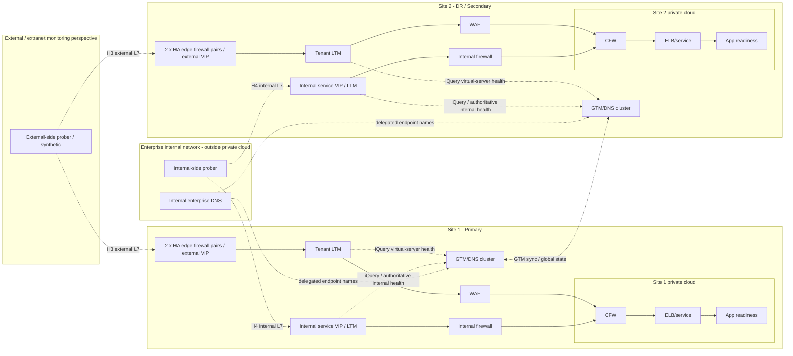

# EnterpriseWAF Future Architecture Improvements

**Status:** Target-state / to-be end-to-end application-delivery guidance  
**Current-state source:** [current_architecture_and_invariants.md](./current_architecture_and_invariants.md)  
**Purpose:** Keep proposed target-state improvements (layered end-to-end health monitoring, cross-site contingency, and future hardware/BIG-IP rebuild) separate from the validated BIG-IP 17.5.x current-state baseline. Execution starts with the **WAF tier** (and its F5 LTM/GTM interfaces) while aligning partner-owned tiers (Network/Security firewalls, Cloud Platform CFW/ELB, and Application teams) through explicit readiness and recovery contracts.

# 1. Target decision

The target health model should be **layered**.

> **BIG-IP DNS/GTM should own the global endpoint/site decision, but it should not be the only place where health is detected and it does not need to originate every probe itself.**

The preferred model is:

1. **native HA** detects device/peer failure;
2. **LTM / ELB / service-tier health** removes failed local members quickly;
3. **GTM owns external and internal published-endpoint availability** used for DNS/site selection;
4. the **probe origin is chosen so the check crosses the failure domain GTM is deciding about**;
5. application teams own the Layer-7 readiness contract;
6. independent external/internal synthetic monitoring measures the actual 99.95% service outcome.

This keeps the recovery domain proportional to the failure. One backend, WAF node or pool member should normally stay a local recovery event rather than trigger DNS/site failover.

# 2. The important distinction: decision owner versus probe origin

The best place for the **decision** and the best place for the **probe** are not always the same.

| Decision | Decision owner | Preferred health source / probe origin | Reason |
|---|---|---|---|
| one HA peer/device | native HA subsystem | peer/device health | fastest local takeover |
| one WAF/backend/pool member | LTM / ELB / service tier | local protocol/L7 member monitor | remove only the failed member |
| **external site/VIP selection** | **GTM/DNS** | L7 probe from an **external/extranet-representative vantage** where possible; otherwise a useful GTM prober/LTM+iQuery signal plus external synthetic confirmation | GTM controls the external DNS answer, but a probe originating inside the edge may not prove the full external path |
| **internal delegated-name/site selection** | **GTM/DNS** | L7 probe from an **internal-network vantage before the internal firewall**, or authoritative internal LTM health exported through iQuery | proves the internal VIP path that internal DNS is delegating to GTM |
| B1/B2 dependency selection | service VIP/LTM/service discovery; GTM only if GTM owns that endpoint selection | dependency-specific health | avoids broad application/site failover |
| 99.95% SLO | monitoring/SRE platform | independent user-like synthetic | measures real service outcome rather than infrastructure state |

## Target rule

> **GTM owns the answer; the probe should be sourced from a location that actually exercises the path represented by that answer.**

This is especially important because the GTM clusters are inside the edge-firewall boundary. A GTM-originated monitor can validate application reachability, but depending on routing/NAT it may not reproduce the same inbound path used by an external customer.

# 3. Recommended health layers

| Health layer | Best place | What it proves | Action it should drive |
|---|---|---|---|
| **H1 - device / HA liveness** | firewall/LTM/WAF/CFW native HA | peer/process/interface availability | local HA takeover only |
| **H2 - local member health** | LTM / ELB / closest service tier | member or WAF-node readiness | remove failed member locally |
| **H3 - external published endpoint** | GTM-owned health using a representative external/extranet prober, direct GTM L7 monitor, and/or authoritative iQuery signal | external VIP path to application readiness | external wide-IP/site choice |
| **H4 - internal published endpoint** | GTM-owned health using an internal-zone prober or authoritative internal LTM/iQuery signal | internal VIP -> internal firewall -> CFW -> ELB -> application | internal delegated-name/site choice |
| **H5 - dependency/service health** | service VIP/LTM/service discovery | B1/B2 or other dependency readiness | dependency-local recovery |
| **H6 - independent synthetic** | monitoring platform outside the traffic-management stack | real external/internal/API business transaction | SLO measurement, alerting, failover validation |

GTM should therefore be the **authoritative site/endpoint steering layer**, but not the only health-check layer.

# 4. Target external VIP health

For every critical externally published application, GTM should have an authoritative Layer-7 view of each site's external endpoint.

Target path to prove:

```text
external/extranet health vantage
  -> private leased line / VPN path where feasible
  -> edge firewall / external application VIP
  -> tenant LTM
  -> WAF
  -> CFW
  -> ELB/service
  -> application readiness endpoint
```

## Preferred probe order

1. **Best representation:** a prober/synthetic vantage that actually traverses the external/extranet ingress path.
2. **Useful infrastructure signal:** direct GTM HTTP/HTTPS monitor if routing makes its path representative enough.
3. **Useful authoritative local signal:** LTM virtual-server/application health exported to GTM through iQuery.
4. **Independent external synthetic:** always recommended for SLO evidence even when it is not the automatic steering signal.

A GTM located behind the edge firewall can legitimately perform application L7 monitoring, but that does not automatically prove customer leased-line reachability or the outside-to-inside firewall path. Document exactly what each probe crosses.

# 5. Target internal VIP health

Internal clients continue to use **internal enterprise DNS**. Only selected endpoint names/namespaces should be delegated or conditionally forwarded to GTM when site-aware endpoint selection is required.

Target resolution path:

```text
internal client
  -> internal enterprise DNS
  -> delegated / conditionally forwarded namespace
  -> enterprise edge GTM/DNS
  -> healthy internal service VIP
```

Target application path to prove:

```text
internal-network health vantage
  -> internal service/LTM VIP
  -> internal firewall
  -> private-cloud CFW
  -> ELB/service
  -> application readiness endpoint
```

For internal VIP health, prefer:

- a GTM-designated prober that can reach the internal VIP from the correct internal-network side; or
- an internal LTM Layer-7 monitor whose virtual-server/application state is exported to GTM via iQuery.

Do not require every internal name to use GTM. Use GTM only for names where global/site-aware selection provides value.

# 6. Separate external and internal endpoint state

The same application can have different health on the two access paths.

Examples:

- external unhealthy / internal healthy: edge firewall, leased-line, WAF or external VIP problem;
- internal unhealthy / external healthy: internal LTM/VIP or internal-firewall problem;
- both unhealthy: CFW, ELB, application or common dependency problem.

Do not collapse these into one generic application state unless the business intentionally wants both namespaces withdrawn together.

Where GTM serves both external and delegated internal namespaces, keep the **wide-IP/pool/monitor policy separate enough to represent the different endpoint paths**.

# 7. Direct GTM monitor, iQuery, and prober pools

F5 BIG-IP DNS supports direct health monitors and integration with BIG-IP LTM through iQuery. It also supports selecting probing systems/prober pools and availability requirements.

The target should use these capabilities according to path fidelity rather than picking one mechanism globally.

## 7.1 Direct GTM Layer-7 monitor

Use when the selected GTM/prober can reach the target VIP through a path that usefully represents the endpoint being advertised.

The monitor should verify more than TCP connect. For HTTP/HTTPS, use a stable send/receive contract so the monitor confirms expected application content/readiness.

## 7.2 LTM/iQuery health and firewall NAT considerations

Use when LTM is the better observer of the local application path or when direct GTM probing cannot safely/reliably traverse the desired path.

```text
LTM performs L7 service/path health
        |
        v
BIG-IP DNS/GTM consumes virtual-server health via iQuery
        |
        v
GTM makes external/internal site-selection decision
```

**F5 BIG-IP DNS / LTM integration guardrails (official F5 docs):**

- **Firewall NAT & disabled Auto-Discovery (`K14707`, `K9138`):** Because external application VIPs live on the edge firewall (NATted to private LTM VIPs), BIG-IP DNS server/virtual-server objects must be configured with the external firewall VIP as `Address` and the private LTM VIP as `Translation`, and firewall policy must permit **TCP 4353 (iQuery)**. Specifying a `Translation` address **automatically disables Virtual Server Auto-Discovery** (`K9138`), so virtual-server inventory must be explicitly managed (or automated via AS3/BIG-IQ) to prevent drift.
- **Avoid duplicate monitoring (`K5431`):** When using the `bigip` monitor over iQuery, do not stack redundant direct monitors on both the LTM virtual server and the GTM virtual server unless a separate path-verification perspective is intentionally required.

## 7.3 Prober pools / multiple perspectives

For critical services, define explicitly:

- which systems probe Site 1 external VIPs;
- which systems probe Site 2 external VIPs;
- which systems probe internal VIPs;
- whether a local and a remote/corroborating perspective are used;
- how many successful probes are required;
- how inter-site network loss should affect the result.

**F5 prober-pool guardrails (official F5 docs):**

- Without explicit **Prober Pools** (`Specific Prober Pool`, `K08433560`), BIG-IP DNS dynamically delegates probing across any `big3d` device in the data center (`K8170`).
- F5 documents (`K000163083`) that after maintenance or iQuery reconnection, BIG-IP DNS may temporarily pick an LTM outside the configured prober pool; if that device lacks routes to the target across segmented firewall zones, probes fail with `no route` and mark healthy endpoints down. Validate routing and prober-pool fallback behavior explicitly.
- When an LTM in a prober pool runs a non-`bigip` monitor (such as TCP/HTTP) against a virtual server local to itself without SNAT, F5 documents (`K000159606`) potential physical-MAC vs. MAC-masquerade flapping on the network.

Use `All`, `At Least`, or `Require` semantics only after testing the failure behavior. **Do not create a design where loss of the inter-site link alone marks an otherwise healthy local site down.**

# 8. Canonical target health diagram



The exact prober product/location is an implementation choice. The architectural requirement is that the selected signal proves the intended access path closely enough for the DNS decision it drives.

# 9. Application-team Layer-7 health contract

Layer-7 health only works when the application team defines what **ready to accept new traffic** means.

Each protected endpoint should have a health contract covering:

| Field | Required decision |
|---|---|
| hostname / SNI | exact host sent by the monitor |
| URI | stable readiness endpoint, e.g. `/health/ready` |
| method | normally GET/HEAD unless justified otherwise |
| expected status | e.g. HTTP 200 |
| expected content | small stable receive string where useful |
| authentication | none, dedicated credential, certificate or token as appropriate |
| critical dependencies | dependencies that must be available to accept traffic |
| non-critical dependencies | dependencies that should not withdraw the whole service |
| timeout | normal/degraded response boundary |
| maintenance semantics | how the application intentionally leaves service (e.g., returning a **Receive Disable String** per F5 `K12818` so LTM/ELB drains traffic cleanly before shutdown) |
| owner | application team responsible for versioning the contract |

## Avoid false green

```text
TCP 443 works
  -> WAF/LTM looks healthy
  -> CFW/ELB/application is broken
  -> GTM still advertises the site
```

**F5 LTM Virtual Server false-green guardrail (`K40554304`):** By default (`Immediate Action On Service Down = None`), a BIG-IP LTM virtual server continues to complete TCP 3-way handshakes even when all pool members are offline. Set `Immediate Action On Service Down = Reject` or `Drop` on virtual servers where upstream TCP probes must not see a false-green listener.

## Avoid false red and cascades

Do not make App A globally unhealthy simply because an optional/non-critical App B/C feature is degraded. Otherwise one shared dependency can cause GTM to withdraw several healthy applications and create an avoidable site failover.

# 10. Health action boundaries

| Failure | Preferred detector | Preferred action |
|---|---|---|
| one backend/Pod/VM | ELB/LTM/service monitor | remove member locally |
| one independent WAF node | LTM WAF-pool monitor | remove WAF locally |
| one LTM peer | BIG-IP HA | local peer takeover |
| one CFW member | CFW HA | local firewall takeover |
| whole external endpoint path unusable | GTM external endpoint health | change external wide-IP/site answer |
| whole internal endpoint path unusable | GTM internal endpoint health | change delegated internal endpoint/site answer |
| App B local instance fails | B service VIP/service discovery | B1 -> B2 where safe |
| whole site lost | GTM + site/application readiness | Site 2 recovery |

# 11. GTM synchronization and convergence target

Measure the site failover as separate stages:

```text
1. path/service fails
2. local detector/prober sees failure
3. GTM obtains authoritative unhealthy state
4. GTM synchronization/global state converges where required
5. alternate endpoint becomes eligible
6. GTM returns the alternate answer
7. residual DNS TTL/cache expires or client re-resolves
8. application/session/socket recovery completes (T6)
```

If each site has direct/cross-site visibility of the relevant endpoint, step 3/4 may be faster and less dependent on indirect state learning.

If GTM probes are site-local only, **measure and include the remote GTM state-learning/synchronization delay**. DNS TTL is not the whole failover time.

# 12. Independent synthetics and the 99.95% SLO

Add independent user-like tests from representative viewpoints:

- external/private-network client perspective;
- internal desktop/system perspective;
- important API/system perspective.

Use them for:

- 99.95% SLO measurement;
- business transaction/error-rate validation;
- confirming DNS/firewall/authentication issues that infrastructure monitors can miss;
- validating failover and maintenance tests.

Normally, independent synthetic monitoring should **confirm** availability rather than be the only automatic GTM steering input unless its false-positive and timing behavior have been explicitly proven.

# 13. Dependency-local recovery

For App A/D -> B -> C chains, prefer dependency-local recovery before broad application/site failover where business semantics allow it.

```text
App A / App D
      |
B service VIP / discovery
   /             \
B1 Site 1      B2 Site 2
preferred       fallback
      |
    App C
```

Required controls include bounded timeouts, retry with backoff/jitter, circuit breaker/bulkhead, idempotency/reconciliation, compatible state/data, service identity, fallback capacity and pre-approved routing/firewall policy.

Healthy local applications must not depend on the inter-site link during normal operation.

# 14. Cross-site delivery improvements

Evaluate as **target contingency capabilities**, not current-state assumptions:

- **X2A** - surviving local LTM borrows a remote WAF and routes back to the healthy local application;
- **X2B** - remote front end routes back to a healthy primary-site application;
- **XD1** - App A/D stays local but uses remote App B;
- **X2C** - conventional full site/application failover.

Prefer the smallest safe recovery domain.

# 15. WAF topology and maintainability

Continue to evaluate:

1. **S1 - tenant-specific LTM pairs + shared independent active WAF pool** as the leading cost/resilience candidate on dedicated/current BIG-IP 17.5.x appliances;
2. **dedicated W1 with three independent WAFs per tenant/site** as the high-isolation fallback (or **F5OS-isolated dedicated per-tenant WAF tenants on shared rSeries/VELOS hardware** during the target rebuild — see §15A);
3. W3 where dedicated normal-state WAFs plus shared reserve are operationally preferred;
4. W2 where simple HA and connection mirroring matter more than horizontal WAF scale.

Whichever topology is selected must support rolling maintenance, staged/canary WAF policy deployment, application-level policy isolation, rollback, required N-1/N-2 capacity and one planned maintenance event plus one additional credible failure where the SLO requires it.

## 15A. Platform rebuild impact: BIG-IP 17.5.x (current) vs. newer devices and BIG-IP 21.1.x+ / F5OS (future)

The current estate runs **BIG-IP 17.5.x** (End of Technical Support: **January 1, 2029**, MyF5 `K15643`), and the target state assumes a rebuild onto newer F5 hardware and software (**rSeries / VELOS running F5OS** with **BIG-IP 21.1.x**, EoTS **May 5, 2029**, or subsequent BIG-IP 22.x/23.x releases). Note that **BIG-IP Next 20.x reached EoTS on April 30, 2025** (`K15643`), so the supported target path is modern BIG-IP TMOS on F5OS (rSeries/VELOS) or VE.

### What DOES change the recommendations (and why)

| Newer Platform / BIG-IP 21.1.x+ Feature | How It Changes Recommendations | Why (Verified F5 Basis) |
|---|---|---|
| **F5OS Hardware Multi-Tenancy (rSeries / VELOS)** | **Reframes S1 vs. Dedicated W1:** Instead of accepting S1's shared-OS/shared-upgrade blast radius to reduce appliance count, you can run **dedicated per-tenant BIG-IP WAF tenants on shared rSeries/VELOS hardware** (providing S1-like hardware consolidation with Dedicated-W1 OS, RBAC, policy, and upgrade isolation). | Each F5OS tenant runs an isolated BIG-IP TMOS instance with dedicated vCPU, memory, disk, management IP, and software image (`F5OS Tenant Management`). **Hardware fault rule:** spread each tenant's 2–3 active WAF tenants across *separate physical rSeries appliances or VELOS blades/chassis* so one physical host failure remains an N-1 event. Note: `r2000` does not support multi-tenancy (`r2800` supports up to 2 on F5OS-A 1.8+; `r4000`/`r5000`/`r10000`/`r12000` and VELOS support full multi-tenancy). |
| **BIG-IP 21.x hardware drop of legacy appliances** | **Makes hardware rebuild mandatory before 21.x:** Cannot upgrade iSeries/VIPRION/vCMP to BIG-IP 21.x in place. Plan a parallel greenfield/blue-green rebuild using `platform-migrate validate`. | BIG-IP 21.x is **not supported on iSeries, VIPRION, or vCMP** — only rSeries, VELOS, and VE (`BIG-IP 21.1.0 New Features`). Use `tmsh load sys ucs <file> platform-migrate validate` (new in 21.1.0, `K82540512`); note 21.1.0 strips HA-group trunks on migration and requires >= 88 GB tenant virtual disk (vs. 86 GB on 17.5.x, `K45191957`/`K000164011`). |
| **`cloud-init` for F5OS tenants (BIG-IP 21.1.0+)** | **Reduces W1/S1/W3 operational drift & rebuild RTO:** Supports declarative first-boot tenant onboarding (paired with AS3/BIG-IQ), making 3+ node independent WAF pools significantly easier to keep consistent and rebuild rapidly. | Native `cloud-init` support on VELOS/rSeries F5OS tenants automates onboarding and declarative configuration (`BIG-IP 21.1.0 Cloud-Init Support`). |
| **64-bit BIG-IP + `bigd` scale + SNAT pool IPs in in-TMM monitors + OOM priority** | **Improves target H2/H3/H4 L7 monitoring reliability at scale** and reduces monitor-daemon bottlenecks in large four-tenant estates. | Documented in `BIG-IP 21.1.0 New Features`. |
| **ACMEv2, TLS 1.3 default parent profiles, X25519 HW offload, Hybrid Post-Quantum TLS & Modern WAF (OpenAPI 3.1, HTTP/3 WAF, MCP)** | **Lowers certificate-expiry outage risk** (a frequent real-world 99.95% breaker) and prepares WAF for modern APIs/AI workloads without redesigning LTM/WAF topology. | `BIG-IP 21.1.0 New Features` adds native ACMEv2, `SecP256rMLKEM768`/`SecP384rMLKEM1024`, OpenAPI 3.1, MCP inspection/persistence, client-side HTTP/3 WAF (LTM HTTP/3 remains experimental; no BADOS yet), and Multi-RPZ (up to 65,535 zones) on BIG-IP DNS. |

### What does NOT change on BIG-IP 21.1.x+

- **Rolling maintenance & N-1/N-2 headroom remain mandatory:** In-place upgrade in BIG-IP **21.1.x is still experimental** and components requiring reboot still take the node offline (full in-place upgrade support starts in **BIG-IP 22.0.x** per `Upgrading to BIG-IP Version 21.1.0`). Do **not** relax node-draining or N-1/N-2 sizing requirements on 21.1.x.
- **AWAF/ASM connection mirroring limits are unchanged:** Still max 2 devices, requires licensed & provisioned LTM, resets on 3rd-device failover, and resets on failback (`BIG-IP 21.1 ASM Connection Mirroring Limitations`). AT3 WebSocket applications **must** still implement client reconnect/backoff/re-auth/replay.
- **Core control/data-plane fundamentals remain unchanged:** DSC single active owner per traffic group, GTM-first + `big3d_install` upgrade order (`K25923322`), NAT `Translation` disabling GTM auto-discovery (`K14707`/`K9138`), DNS TTL vs. established TCP sockets, and App A/B/C/D dependency cascade risk all apply identically.

# 16. Implementation sequence

## Phase 0 - inventory current state

Confirm:

- current GTM monitor types, targets and aliases (including NAT `Address`/`Translation` mappings per `K14707`);
- current external and internal wide-IP/pool structure;
- current delegated internal namespaces;
- iQuery/LTM integration and TCP 4353 firewall rules;
- GTM prober pools / probe sources / availability requirements;
- cross-site probing behavior;
- monitor intervals/timeouts;
- LTM `Action On Service Down` and VS `Immediate Action On Service Down` settings;
- application readiness endpoints;
- independent synthetic monitoring.

## Phase 1 - define application health contracts

Prioritize critical externally/internal published endpoints and shared dependencies.

## Phase 2 - implement Layer-7 published-endpoint health

Implement GTM-authoritative external and internal endpoint health using the best available representative probe source, direct L7 monitors and/or LTM+iQuery.

## Phase 3 - improve prober diversity and global visibility

Test application failure, WAF failure, CFW failure, site failure and inter-site network partition.

## Phase 4 - dependency-local recovery

Pilot B1 -> B2 where state/data/business semantics allow it.

## Phase 5 - cross-site WAF/front-end contingency

Pilot X2A/X2B only after routing, NAT/SNAT, stateful firewall, capacity and ownership are agreed.

## Phase 6 - prove the 99.95% design

Measure p50/p95/p99 fault-to-successful-business-transaction time for external, internal, stateful/WebSocket and dependency scenarios, including planned maintenance plus a second failure.

# 17. Acceptance gates

Before calling the target health architecture ready:

1. external and internal endpoint health are modelled separately where their paths differ;
2. every GTM steering signal has a documented **probe origin and traversed path**;
3. Layer-7 monitors prove application readiness rather than simple TCP reachability;
4. application teams own the health contract;
5. one failed member remains a local recovery event;
6. GTM does not advertise a site whose required endpoint path is unusable;
7. inter-site link failure alone does not withdraw a healthy local site;
8. GTM/prober/synchronization convergence is measured;
9. internal delegated-name behavior and external DNS behavior are tested separately;
10. App A/B/C/D dependency cascades are tested;
11. independent synthetic monitoring measures the user/business outcome;
12. planned maintenance, rollback and failback are tested within the 99.95% objective.

# 18. F5 official documentation reference summary

| Domain | Verified Capability / Constraint | Applies To | Official F5 Reference |
|---|---|---|---|
| **BIG-IP DNS + LTM / NAT** | External firewall VIPs require `Address` + `Translation` in BIG-IP DNS, TCP 4353 iQuery, and disable VS Auto-Discovery | 17.5.x & 21.1.x | [MyF5 K14707](https://my.f5.com/manage/s/article/K14707), [K55502976](https://my.f5.com/manage/s/article/K55502976), [BIG-IP 17.5 DNS+LTM](https://techdocs.f5.com/en-us/bigip-17-5-0/big-ip-dns-implementations/integrating-big-ip-dns-into-a-network-with-big-ip-ltm-systems.html) |
| **BIG-IP DNS Prober Pools & Monitors** | Avoid duplicate LTM+GTM VS monitors; configure `Specific Prober Pool`; validate reconnect fallback (`no route`) & non-`bigip` local probe MAC flapping | 17.5.x & 21.1.x | [MyF5 K5431](https://my.f5.com/manage/s/article/K5431), [K8170](https://my.f5.com/manage/s/article/K8170), [K08433560](https://my.f5.com/manage/s/article/K08433560), [K000163083](https://my.f5.com/manage/s/article/K000163083), [K000159606](https://my.f5.com/manage/s/article/K000159606), [K15408](https://my.f5.com/manage/s/article/K15408) |
| **BIG-IP DNS Upgrade Order** | Upgrade BIG-IP DNS first, then update `big3d` on monitored LTMs via `big3d_install` | 17.5.x & 21.1.x | [MyF5 K25923322](https://my.f5.com/manage/s/article/K25923322), [K13703](https://my.f5.com/manage/s/article/K13703) |
| **LTM False-Green & Graceful Drain** | Set VS `Immediate Action On Service Down = Reject/Drop` to stop TCP 3WHS false-greens; pool `Action On Service Down = Reject` for fast reconnect; `Receive Disable String` + `Disabled` vs `Forced Offline` | 17.5.x & 21.1.x | [MyF5 K40554304](https://my.f5.com/manage/s/article/K40554304), [K15095](https://my.f5.com/manage/s/article/K15095), [K12818](https://my.f5.com/manage/s/article/K12818), [K13310](https://my.f5.com/manage/s/article/K13310) |
| **AWAF Mirroring, Policies & WebSockets** | Mirroring needs licensed+provisioned LTM (max 2 devices; no 3rd failover/failback); WebSocket profile required & incompatible with OneConnect; Parent/Child policies; Live Update staging | 17.5.x & 21.1.x | [BIG-IP 21.1 ASM Mirroring Limitations](https://techdocs.f5.com/en-us/bigip-21-1-0/big-ip-asm-implementations/connection-mirroring-with-asm/connection-mirroring-limitations.html), [Policy Settings](https://techdocs.f5.com/en-us/bigip-21-1-0/big-ip-asm-implementations/changing-security-policy-settings.html), [MyF5 K84421441](https://my.f5.com/manage/s/article/K84421441), [K000151124](https://my.f5.com/manage/s/article/K000151124), [K82512024](https://my.f5.com/manage/s/article/K82512024) |
| **Rebuild: BIG-IP 21.1.x / F5OS / rSeries / VELOS** | Hardware-isolated F5OS tenants (not on r2000); 21.x drops iSeries/VIPRION/vCMP; 17.5.x EoTS Jan 2029; 21.1.x EoTS May 2029; BIG-IP Next 20.x EoTS Apr 2025; `cloud-init`; `platform-migrate validate`; experimental in-place upgrade in 21.1.x (full in 22.0.x); ACMEv2, OpenAPI 3.1, HTTP/3 WAF, MCP, PQC TLS, Multi-RPZ | 21.1.x / F5OS | [BIG-IP 21.1.0 New Features](https://techdocs.f5.com/en-us/bigip-21-1-0/big-ip-release-notes/big-ip-new-features.html), [Upgrade 21.1](https://techdocs.f5.com/en-us/bigip-21-1-0/big-ip-release-notes/big-ip-upgrade.html), [Cloud-Init](https://techdocs.f5.com/en-us/bigip-21-1-0/big-ip-f5os-cloud-init-support-velos-rseries/cloud-init-support-velos-rseries.html), [F5OS Tenant Mgmt](https://techdocs.f5.com/en-us/f5os-a-1-5-0/f5-rseries-systems-administration-configuration/title-tenant-management.html), [VELOS Getting Started](https://techdocs.f5.com/en-us/f5os-2-0-0/velos-systems-getting-started/getting-started-with-velos.html), [MyF5 K15643](https://my.f5.com/manage/s/article/K15643), [K000163422](https://my.f5.com/s/article/K000163422), [K82540512](https://my.f5.com/manage/s/article/K82540512), [K45191957](https://my.f5.com/manage/s/article/K45191957) |

Validate exact configuration syntax and behavior against the deployed BIG-IP release before implementation.
