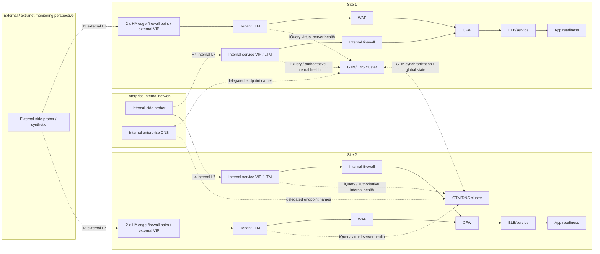

# EnterpriseWAF Future Architecture Improvements

**Status:** Target-state / to-be architecture guidance  
**Current-state source:** [enterprise_scenario_invariants.md](./enterprise_scenario_invariants.md)  
**Current-state topology:** [high_level_architecture.md](./high_level_architecture.md)  
**Purpose:** Keep proposed improvements separate from the current-state / invariant baseline.

# 1. Target decision

The target health model should be **layered**.

> **BIG-IP DNS/GTM should own the global endpoint/site decision, but it should not be the only place where health is detected and it does not need to originate every probe itself.**

The preferred model is:

1. **native HA** detects device/peer failure;
2. **LTM / ELB / service-tier health** removes failed local members quickly;
3. **GTM owns external and internal published-endpoint availability** used for DNS/site selection;
4. the **probe origin is chosen so the check crosses the failure domain GTM is deciding about**;
5. application teams own the Layer-7 readiness contract;
6. independent external/internal synthetic monitoring measures the actual 99.95% service outcome.

This keeps the recovery domain proportional to the failure. One backend, WAF node or pool member should normally stay a local recovery event rather than trigger DNS/site failover.

# 2. The important distinction: decision owner versus probe origin

The best place for the **decision** and the best place for the **probe** are not always the same.

| Decision | Decision owner | Preferred health source / probe origin | Reason |
|---|---|---|---|
| one HA peer/device | native HA subsystem | peer/device health | fastest local takeover |
| one WAF/backend/pool member | LTM / ELB / service tier | local protocol/L7 member monitor | remove only the failed member |
| **external site/VIP selection** | **GTM/DNS** | L7 probe from an **external/extranet-representative vantage** where possible; otherwise a useful GTM prober/LTM+iQuery signal plus external synthetic confirmation | GTM controls the external DNS answer, but a probe originating inside the edge may not prove the full external path |
| **internal delegated-name/site selection** | **GTM/DNS** | L7 probe from an **internal-network vantage before the internal firewall**, or authoritative internal LTM health exported through iQuery | proves the internal VIP path that internal DNS is delegating to GTM |
| B1/B2 dependency selection | service VIP/LTM/service discovery; GTM only if GTM owns that endpoint selection | dependency-specific health | avoids broad application/site failover |
| 99.95% SLO | monitoring/SRE platform | independent user-like synthetic | measures real service outcome rather than infrastructure state |

## Target rule

> **GTM owns the answer; the probe should be sourced from a location that actually exercises the path represented by that answer.**

This is especially important because the GTM clusters are inside the edge-firewall boundary. A GTM-originated monitor can validate application reachability, but depending on routing/NAT it may not reproduce the same inbound path used by an external customer.

# 3. Recommended health layers

| Health layer | Best place | What it proves | Action it should drive |
|---|---|---|---|
| **H1 - device / HA liveness** | firewall/LTM/WAF/CFW native HA | peer/process/interface availability | local HA takeover only |
| **H2 - local member health** | LTM / ELB / closest service tier | member or WAF-node readiness | remove failed member locally |
| **H3 - external published endpoint** | GTM-owned health using a representative external/extranet prober, direct GTM L7 monitor, and/or authoritative iQuery signal | external VIP path to application readiness | external wide-IP/site choice |
| **H4 - internal published endpoint** | GTM-owned health using an internal-zone prober or authoritative internal LTM/iQuery signal | internal VIP -> internal firewall -> CFW -> ELB -> application | internal delegated-name/site choice |
| **H5 - dependency/service health** | service VIP/LTM/service discovery | B1/B2 or other dependency readiness | dependency-local recovery |
| **H6 - independent synthetic** | monitoring platform outside the traffic-management stack | real external/internal/API business transaction | SLO measurement, alerting, failover validation |

GTM should therefore be the **authoritative site/endpoint steering layer**, but not the only health-check layer.

# 4. Target external VIP health

For every critical externally published application, GTM should have an authoritative Layer-7 view of each site's external endpoint.

Target path to prove:

```text
external/extranet health vantage
  -> private leased line / VPN path where feasible
  -> edge firewall / external application VIP
  -> tenant LTM
  -> WAF
  -> CFW
  -> ELB/service
  -> application readiness endpoint
```

## Preferred probe order

1. **Best representation:** a prober/synthetic vantage that actually traverses the external/extranet ingress path.
2. **Useful infrastructure signal:** direct GTM HTTP/HTTPS monitor if routing makes its path representative enough.
3. **Useful authoritative local signal:** LTM virtual-server/application health exported to GTM through iQuery.
4. **Independent external synthetic:** always recommended for SLO evidence even when it is not the automatic steering signal.

A GTM located behind the edge firewall can legitimately perform application L7 monitoring, but that does not automatically prove customer leased-line reachability or the outside-to-inside firewall path. Document exactly what each probe crosses.

# 5. Target internal VIP health

Internal clients continue to use **internal enterprise DNS**. Only selected endpoint names/namespaces should be delegated or conditionally forwarded to GTM when site-aware endpoint selection is required.

Target resolution path:

```text
internal client
  -> internal enterprise DNS
  -> delegated / conditionally forwarded namespace
  -> enterprise edge GTM/DNS
  -> healthy internal service VIP
```

Target application path to prove:

```text
internal-network health vantage
  -> internal service/LTM VIP
  -> internal firewall
  -> private-cloud CFW
  -> ELB/service
  -> application readiness endpoint
```

For internal VIP health, prefer:

- a GTM-designated prober that can reach the internal VIP from the correct internal-network side; or
- an internal LTM Layer-7 monitor whose virtual-server/application state is exported to GTM via iQuery.

Do not require every internal name to use GTM. Use GTM only for names where global/site-aware selection provides value.

# 6. Separate external and internal endpoint state

The same application can have different health on the two access paths.

Examples:

- external unhealthy / internal healthy: edge firewall, leased-line, WAF or external VIP problem;
- internal unhealthy / external healthy: internal LTM/VIP or internal-firewall problem;
- both unhealthy: CFW, ELB, application or common dependency problem.

Do not collapse these into one generic application state unless the business intentionally wants both namespaces withdrawn together.

Where GTM serves both external and delegated internal namespaces, keep the **wide-IP/pool/monitor policy separate enough to represent the different endpoint paths**.

# 7. Direct GTM monitor, iQuery, and prober pools

F5 BIG-IP DNS supports direct health monitors and integration with BIG-IP LTM through iQuery. It also supports selecting probing systems/prober pools and availability requirements.

The target should use these capabilities according to path fidelity rather than picking one mechanism globally.

## 7.1 Direct GTM Layer-7 monitor

Use when the selected GTM/prober can reach the target VIP through a path that usefully represents the endpoint being advertised.

The monitor should verify more than TCP connect. For HTTP/HTTPS, use a stable send/receive contract so the monitor confirms expected application content/readiness.

## 7.2 LTM/iQuery health

Use when LTM is the better observer of the local application path or when direct GTM probing cannot safely/reliably traverse the desired path.

```text
LTM performs L7 service/path health
        |
        v
BIG-IP DNS/GTM consumes virtual-server health via iQuery
        |
        v
GTM makes external/internal site-selection decision
```

## 7.3 Prober pools / multiple perspectives

For critical services, define explicitly:

- which systems probe Site 1 external VIPs;
- which systems probe Site 2 external VIPs;
- which systems probe internal VIPs;
- whether a local and a remote/corroborating perspective are used;
- how many successful probes are required;
- how inter-site network loss should affect the result.

Use `All`, `At Least`, or `Require` semantics only after testing the failure behavior. **Do not create a design where loss of the inter-site link alone marks an otherwise healthy local site down.**

# 8. Canonical target health diagram



The exact prober product/location is an implementation choice. The architectural requirement is that the selected signal proves the intended access path closely enough for the DNS decision it drives.

# 9. Application-team Layer-7 health contract

Layer-7 health only works when the application team defines what **ready to accept new traffic** means.

Each protected endpoint should have a health contract covering:

| Field | Required decision |
|---|---|
| hostname / SNI | exact host sent by the monitor |
| URI | stable readiness endpoint, e.g. `/health/ready` |
| method | normally GET/HEAD unless justified otherwise |
| expected status | e.g. HTTP 200 |
| expected content | small stable receive string where useful |
| authentication | none, dedicated credential, certificate or token as appropriate |
| critical dependencies | dependencies that must be available to accept traffic |
| non-critical dependencies | dependencies that should not withdraw the whole service |
| timeout | normal/degraded response boundary |
| maintenance semantics | how the application intentionally leaves service |
| owner | application team responsible for versioning the contract |

## Avoid false green

```text
TCP 443 works
  -> WAF/LTM looks healthy
  -> CFW/ELB/application is broken
  -> GTM still advertises the site
```

## Avoid false red and cascades

Do not make App A globally unhealthy simply because an optional/non-critical App B/C feature is degraded. Otherwise one shared dependency can cause GTM to withdraw several healthy applications and create an avoidable site failover.

# 10. Health action boundaries

| Failure | Preferred detector | Preferred action |
|---|---|---|
| one backend/Pod/VM | ELB/LTM/service monitor | remove member locally |
| one independent WAF node | LTM WAF-pool monitor | remove WAF locally |
| one LTM peer | BIG-IP HA | local peer takeover |
| one CFW member | CFW HA | local firewall takeover |
| whole external endpoint path unusable | GTM external endpoint health | change external wide-IP/site answer |
| whole internal endpoint path unusable | GTM internal endpoint health | change delegated internal endpoint/site answer |
| App B local instance fails | B service VIP/service discovery | B1 -> B2 where safe |
| whole site lost | GTM + site/application readiness | Site 2 recovery |

# 11. GTM synchronization and convergence target

Measure the site failover as separate stages:

```text
1. path/service fails
2. local detector/prober sees failure
3. GTM obtains authoritative unhealthy state
4. GTM synchronization/global state converges where required
5. alternate endpoint becomes eligible
6. GTM returns the alternate answer
7. residual DNS TTL/cache expires or client re-resolves
8. application/session/socket recovery completes (T6)
```

If each site has direct/cross-site visibility of the relevant endpoint, step 3/4 may be faster and less dependent on indirect state learning.

If GTM probes are site-local only, **measure and include the remote GTM state-learning/synchronization delay**. DNS TTL is not the whole failover time.

# 12. Independent synthetics and the 99.95% SLO

Add independent user-like tests from representative viewpoints:

- external/private-network client perspective;
- internal desktop/system perspective;
- important API/system perspective.

Use them for:

- 99.95% SLO measurement;
- business transaction/error-rate validation;
- confirming DNS/firewall/authentication issues that infrastructure monitors can miss;
- validating failover and maintenance tests.

Normally, independent synthetic monitoring should **confirm** availability rather than be the only automatic GTM steering input unless its false-positive and timing behavior have been explicitly proven.

# 13. Dependency-local recovery

For App A/D -> B -> C chains, prefer dependency-local recovery before broad application/site failover where business semantics allow it.

```text
App A / App D
      |
B service VIP / discovery
   /             \
B1 Site 1      B2 Site 2
preferred       fallback
      |
    App C
```

Required controls include bounded timeouts, retry with backoff/jitter, circuit breaker/bulkhead, idempotency/reconciliation, compatible state/data, service identity, fallback capacity and pre-approved routing/firewall policy.

Healthy local applications must not depend on the inter-site link during normal operation.

# 14. Cross-site delivery improvements

Evaluate as **target contingency capabilities**, not current-state assumptions:

- **X2A** - surviving local LTM borrows a remote WAF and routes back to the healthy local application;
- **X2B** - remote front end routes back to a healthy primary-site application;
- **XD1** - App A/D stays local but uses remote App B;
- **X2C** - conventional full site/application failover.

Prefer the smallest safe recovery domain.

# 15. WAF topology and maintainability

Continue to evaluate:

1. **S1 - tenant-specific LTM pairs + shared independent active WAF pool** as the leading cost/resilience candidate;
2. **dedicated W1 with three independent WAFs per tenant/site** as the high-isolation fallback;
3. W3 where dedicated normal-state WAFs plus shared reserve are operationally preferred;
4. W2 where simple HA and connection mirroring matter more than horizontal WAF scale.

Whichever topology is selected must support rolling maintenance, staged/canary WAF policy deployment, application-level policy isolation, rollback, required N-1/N-2 capacity and one planned maintenance event plus one additional credible failure where the SLO requires it.

# 16. Implementation sequence

## Phase 0 - inventory current state

Confirm:

- current GTM monitor types, targets and aliases;
- current external and internal wide-IP/pool structure;
- current delegated internal namespaces;
- iQuery/LTM integration;
- GTM prober pools / probe sources / availability requirements;
- cross-site probing behavior;
- monitor intervals/timeouts;
- application readiness endpoints;
- independent synthetic monitoring.

## Phase 1 - define application health contracts

Prioritize critical externally/internal published endpoints and shared dependencies.

## Phase 2 - implement Layer-7 published-endpoint health

Implement GTM-authoritative external and internal endpoint health using the best available representative probe source, direct L7 monitors and/or LTM+iQuery.

## Phase 3 - improve prober diversity and global visibility

Test application failure, WAF failure, CFW failure, site failure and inter-site network partition.

## Phase 4 - dependency-local recovery

Pilot B1 -> B2 where state/data/business semantics allow it.

## Phase 5 - cross-site WAF/front-end contingency

Pilot X2A/X2B only after routing, NAT/SNAT, stateful firewall, capacity and ownership are agreed.

## Phase 6 - prove the 99.95% design

Measure p50/p95/p99 fault-to-successful-business-transaction time for external, internal, stateful/WebSocket and dependency scenarios, including planned maintenance plus a second failure.

# 17. Acceptance gates

Before calling the target health architecture ready:

1. external and internal endpoint health are modelled separately where their paths differ;
2. every GTM steering signal has a documented **probe origin and traversed path**;
3. Layer-7 monitors prove application readiness rather than simple TCP reachability;
4. application teams own the health contract;
5. one failed member remains a local recovery event;
6. GTM does not advertise a site whose required endpoint path is unusable;
7. inter-site link failure alone does not withdraw a healthy local site;
8. GTM/prober/synchronization convergence is measured;
9. internal delegated-name behavior and external DNS behavior are tested separately;
10. App A/B/C/D dependency cascades are tested;
11. independent synthetic monitoring measures the user/business outcome;
12. planned maintenance, rollback and failback are tested within the 99.95% objective.

# 18. F5 implementation references

Relevant official F5 capabilities used by this target design include:

- BIG-IP DNS/LTM integration and iQuery;
- BIG-IP DNS HTTP/HTTPS/TCP health monitors;
- send/receive strings for content validation;
- BIG-IP DNS prober pools / device-specific probing;
- BIG-IP DNS availability requirements such as `All`, `At Least`, and `Require`.

Validate exact configuration syntax and behavior against the deployed BIG-IP release before implementation.
