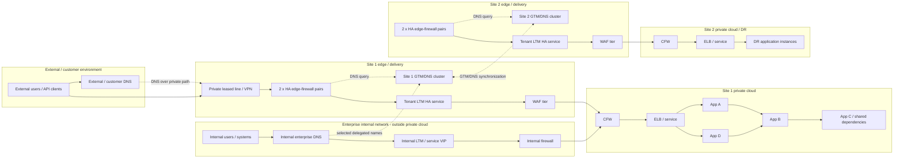

# EnterpriseWAF High-Level Current-State Architecture

**Status:** Canonical current-state topology and layer model  
**Current-state baseline:** [enterprise_scenario_invariants.md](./enterprise_scenario_invariants.md)  
**Future / target-state improvements:** [future_architecture_improvements.md](./future_architecture_improvements.md)

# 1. Purpose

This document shows **what the enterprise architecture looks like today at a high level**, without mixing in unconfirmed target-state improvements.

Use it to ground diagrams and slide decks.

The companion future-state document contains proposed Layer-7 GTM health checks, cross-site probing, dependency fallback and other improvements.

# 2. Layer breakdown

| Layer | Current role | Current boundary |
|---|---|---|
| **L0 - users / resolvers** | external users/API clients, external/customer DNS, internal users, internal enterprise DNS | outside application-delivery/private-cloud stack |
| **L1 - global DNS / site selection** | Site 1 and Site 2 BIG-IP DNS/GTM clusters; selected external/internal names | edge service behind edge firewall |
| **L2 - site edge / ingress** | private leased line/VPN, 2 x 2 edge firewalls, external application VIPs | site edge/security |
| **L3 - local delivery/security** | tenant LTM HA service and WAF tier | tenant application-delivery path |
| **L4 - internal access boundary** | internal LTM/service VIP and internal firewall | enterprise internal network -> private cloud |
| **L5 - private-cloud delivery** | CFW and ELB/service | private-cloud boundary |
| **L6 - business application** | App A/B/C/D, sessions, state, DB, identity, event services | application/platform |
| **L7 - application dependencies** | App A/D -> B -> C and other shared services | application/service architecture |

Health/observability is **cross-cutting** and is not itself one inline layer.

# 3. Current DNS/control-plane model

Each site has a BIG-IP DNS/GTM cluster.

The site GTM clusters communicate/synchronize the enterprise GTM/DNS view.

The same edge GTM service can participate in:

- external/customer DNS resolution for published external services; and
- selected internal endpoint-name/namespace resolution delegated or conditionally forwarded by internal enterprise DNS.

GTM/DNS is not inline in the application TCP/HTTP connection.

## 3.1 External DNS control path

```text
External user/system
  -> external/customer DNS
  -> private leased line / VPN / extranet path
  -> edge firewall
  -> site BIG-IP DNS / GTM cluster
  -> selected external application VIP
```

## 3.2 Internal DNS control path

```text
Internal user/system
  -> internal enterprise DNS
  -> [selected delegated / forwarded namespace]
  -> enterprise edge BIG-IP DNS / GTM
  -> selected internal service/LTM VIP
```

# 4. Current application data paths

## 4.1 External path

```text
External user/API client
  -> private leased line / VPN
  -> edge firewall / external application VIP
  -> tenant LTM HA service
  -> WAF tier
  -> private-cloud CFW
  -> ELB/service
  -> application
```

## 4.2 Internal path

```text
Internal user/system
  -> internal enterprise DNS
  -> [optional edge-GTM delegated name]
  -> internal LTM / service VIP
  -> internal firewall
  -> private-cloud CFW
  -> ELB/service
  -> application
```

The internal firewall and the CFW are distinct layers and distinct failure domains.

# 5. Canonical current-state topology



# 6. Current health-monitoring position

The exact current health-monitoring implementation is **not yet fully confirmed**.

The architecture should therefore show the GTM and monitoring layers without drawing unverified Layer-7 health-check flows as if they are already implemented.

Current validation questions include:

- Does GTM check only IP/port or does it perform HTTP/L7 checks?
- Does GTM check the **external VIP** for each published service?
- Does GTM check the **internal VIP** used by delegated internal names?
- Does GTM consume LTM health using iQuery?
- Do Site 1 and Site 2 GTMs directly probe the alternate site?
- What prober-pool/availability rule is configured?
- What application readiness endpoint exists?
- Does the monitor prove CFW -> ELB -> application reachability?

Until confirmed, these remain **current-state unknowns**, not invariants.

# 7. Current application dependencies

The current failure analysis must treat shared dependencies as first-class:

```text
App A -----\
            -> App B -> App C
App D -----/
```

A failure of App B can affect several otherwise-healthy applications.

The existence of automatic cross-site B1 -> B2 fallback is a **future-state design choice**, not a current-state fact.

# 8. Current topology scope

The current baseline retains:

- the existing GTM model;
- tenant LTM HA service boundaries;
- separate external and internal DNS resolution paths;
- the distinct internal firewall and private-cloud CFW;
- Site 1 / Site 2 as separate failure domains.

The WAF topology itself remains a design variable and is compared as W1/W2/W3/W4 plus S1/S2 sharing patterns in the other analysis documents.

# 9. Current-state diagram rule

A current-state diagram must **not** silently show the following as already implemented unless validated:

- GTM Layer-7 synthetic checks of every external/internal VIP;
- cross-site GTM probing;
- X2A/X2B remote-WAF/front-end routing;
- XD1 B1 -> B2 dependency fallback;
- shared S1 WAF target architecture.

Those belong in the target-state diagram in:

- [future_architecture_improvements.md](./future_architecture_improvements.md)

# 10. Version-controlled diagrams and management artifacts

The management artifacts are under:

- [`../management-artifacts/`](../management-artifacts/)
- [`../management-artifacts/diagrams/`](../management-artifacts/diagrams/)

Use stable filenames; Git history provides versioning.

The management deck should contain **separate current-state and target-state slides** so management can see what exists versus what is proposed.
